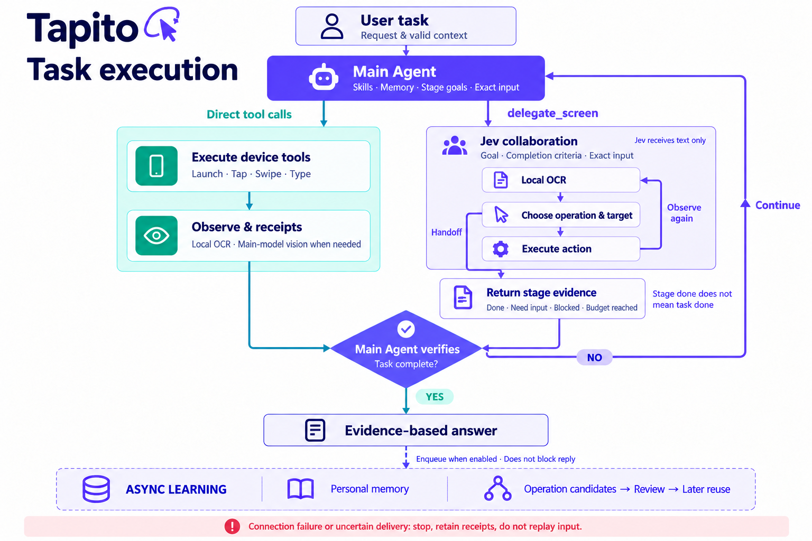
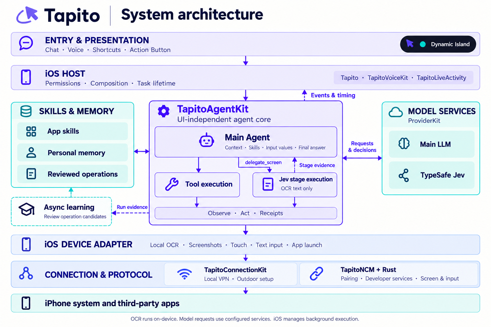

<p align="center">
  
</p>

<h1 align="center">Tapito</h1>
<p align="center"><strong>Tell your iPhone what to do.</strong><br>A personal agent for operating iPhone apps with language, skills and memory.</p>
<p align="center">English · <a href="README.zh-CN.md">简体中文</a></p>
<p align="center"><a href="#get-started">Get started</a> · <a href="#how-it-works">How it works</a> · <a href="#documentation">Documentation</a> · <a href="CONTRIBUTING.md">Contribute</a></p>

Tapito turns a text or voice request into actions in real iPhone apps. It observes the screen, loads relevant skills, calls device tools, and checks the result. Repeated interactions can become reusable page knowledge and workflows; useful personal preferences can become long-term memory.

The agent runs in the iPhone app and calls your configured model services. Device control uses local developer services through an embedded loopback VPN. A Mac is needed for building and initial setup; routine tasks run on the phone while the connection and iOS execution permission remain available.

> **Current distribution:** build from source for **iOS 27 / Xcode 27**. This is an actively developed project. App layouts, model behavior and iOS lifecycle limits affect task completion; a successful build is not a guarantee that every app flow works.

## What can I try?

| Say something like… | What the task involves |
| --- | --- |
| “Open Weibo and tell me the first trending topic.” | Navigate to the ranking, read the current result and answer from what is visible. |
| “Create a note titled Packing list: charger, passport, headphones.” | Open Notes, enter the complete text and check the saved note. |
| “Set a weekday alarm for 7:30 AM.” | Check the time, repeat days and enabled state in Clock. |
| “Find Alex in WeChat and send ‘See you at six.’” | Identify the intended conversation, fill the message and verify the result. |

These are example requests, not a compatibility benchmark. Start with a reading task on your own device before trying actions that send or change data.

### Demo

Real-device recordings will be added here. Planned walkthroughs cover a reading task, text entry and reuse of a learned operation. See the [recording guide](docs/Tapito-DEMO-GUIDE.md) for the shot list and information to include with each clip.

<!-- Add an actual GitHub-uploaded video or a linked poster here after recording. Keep the model, device and timing notes alongside it. -->

## Why Tapito?

- **An assistant on your phone.** Start from chat, voice, Shortcuts or an Action Button control. Follow concise steps in the conversation or Dynamic Island, and stop a running task.
- **OCR before pixels.** Apple Vision extracts text and positions locally. The agent uses screenshots when text cannot resolve an icon, layout or state. Focused text fields receive whole strings instead of individual keyboard taps.
- **Skills when useful.** Built-in guides cover Notes, Clock, WeChat, Weibo and QQ. Other installed apps can use the common iOS tools without a dedicated skill.
- **Learning you can inspect.** Keep personal memory separate from page controls and workflows. Review learned operation candidates before enabling them for later tasks.
- **A replaceable UI and model layer.** Agent, connection, voice and provider modules have separate responsibilities. Both normal execution and Jev collaboration share the same main agent.
- **Visible execution.** Model requests and tool calls show measured durations. Receipts and persistent diagnostics help distinguish a model decision, an unsent action and an uncertain device result.

## Get started

### 1. Prepare the environment

| Requirement | Purpose |
| --- | --- |
| Mac with Xcode 27 and its command-line tools | Build, sign and install the app and its two extensions. |
| Real iPhone running iOS 27 | Exercise cross-app screen and input operations. A simulator does not prove this connection path. |
| Apple signing configuration that supports `packet-tunnel-provider` | Sign both the app and its embedded VPN extension with the required capability. |
| Rust toolchain and Python 3 | Build the native protocol backend and generate the Xcode project. |
| A reachable model endpoint and credentials | Use a model with text generation and tool calling; screen-image tasks also need image support. |

### 2. Build and install

```sh
git clone https://github.com/Y175/Tapito.git
cd Tapito
rustup target add aarch64-apple-ios
python3 ios-app/scripts/generate_xcode_project.py
open ios-app/Tapito.xcodeproj
```

In Xcode, select the **Tapito** scheme and your iPhone. Configure your signing team and bundle identifiers for **Tapito**, **TapitoLiveActivity** and **TapitoLoopbackTunnel**, then build and run. If you change generated project settings, carry those changes into the project configuration/generator before regenerating it. The Xcode build phase compiles the Rust backend.

Enable Developer Mode and use Xcode to prepare a matching developer disk image. Complete the app's pairing setup; installing the app alone does not establish a device-control session. Detailed configuration is in the [iOS guide](ios-app/README.md).

### 3. Connect a model and your phone

1. In **Settings → Providers**, add your endpoint, credentials and model; select a default provider/model. OpenAI-compatible Chat Completions and selectable Responses transport are available. If the endpoint is on your Mac, use an address reachable from the phone: the phone's `127.0.0.1` is not your Mac.
2. In **Settings → Phone Control → Connection & Verification** (`设置 → 手机操控 → 连接与验证`), complete pairing and approve **Tapito 本机连接**. Start the local VPN and verify the control connection.
3. Try a simple reading task, such as “Open Weibo and show me the trending topics.” Check the execution history and the actual page before moving on to longer tasks.

The embedded VPN routes local control traffic; it is not an internet proxy. Another active VPN can conflict with it. Ordinary conversation does not need a device-control connection.

### 4. Optional: voice, Action Button and outdoor setup

- Grant microphone and speech permissions for voice input, and the location authorization required by the selected background mode. **Task execution releases the microphone/audio session and does not listen for interruptions.** Voice listening and result narration are separate phases.
- On supported iPhones, choose **Tapito 语音任务** under **Settings → Action Button → Controls**. iOS controls Dynamic Island expansion and animation behavior.
- Import the bundled **Tapito 户外初始化** Shortcut from connection setup. It prepares a session, enables airplane mode, establishes the offline connection, disables airplane mode and checks recovery. Keep the actions' output variables connected; no manual initialization ID is needed.

If you change the bundle ID, signing team or Intent parameters, regenerate and sign the bundled Shortcut with your own configuration. If an outdoor initialization is interrupted, check that airplane mode has been restored. Background execution and outdoor connectivity remain subject to iOS and network conditions. See the [connection guide](docs/Tapito-CONNECTION.md).

## How it works

**The main model owns the task. Code executes tools and returns evidence.** Tapito uses a ReAct-style tool-call loop; skills provide app knowledge rather than a separate permission list.



1. Assemble the request, valid conversation context, relevant memory and a catalog of skills/tools.
2. Let the model load the common iOS skill and app-specific references as needed. Resolve apps from the installed-app catalog.
3. Execute tool calls serially and return actual results. Observe changed pages with local OCR; request a screenshot only when the task needs visual evidence.
4. Reuse a reviewed page operation or workflow when its current page checks pass. Otherwise, inspect the current page and plan the remaining work.
5. Let the main agent verify the requested outcome and respond. When enabled, asynchronous learning processes the run without blocking the final answer.

### Normal agent or Jev collaboration?

| Responsibility | Normal agent | Jev collaboration |
| --- | --- | --- |
| Context, skills, memory, app choice and final answer | Main model | The same main agent, with an explicitly bound main model |
| Page action selection | Main model through tool calls | Main agent may delegate a stage to Jev, which selects operation and text target from OCR |
| Exact text to enter | Main model | Main model supplies the complete field value; Jev selects when to enter it |
| Image observation | Main model, when requested | Main model, when requested; **Jev receives text only** |
| Completion | Main agent checks the task result | Jev returns stage evidence; the main agent decides whether the whole task is complete |

To use Jev, add **Jev 协同** in provider settings, configure the TypeSafe endpoint/key/model, and explicitly bind a **main Agent provider and model**. Then select that provider in the conversation. The current Jev entry accepts text tasks. It uses the shared skills, memory and learning queue. [Jev setup, contracts and prompts →](docs/Tapito-JEV-OCR.md)

### What does Tapito learn?

**Personal memory** captures relevant, durable facts or preferences from user statements. **Operational knowledge** captures stable UI labels, control bounds, functions and observed page transitions. They have separate storage and management.

Learning runs through a persistent asynchronous queue. Page/workflow candidates become usable after review; active revisions are exposed as references in the corresponding app skill. Manage them under **Settings → Memory & Learning → 页面功能、控件与学习记录**.

A matching learned operation can skip per-step OCR and model calls by checking current local image evidence. It still checks page/version compatibility, and dynamic facts such as a recipient or a sent message must be verified for the current task. Contacts, chat text, feed items and entered values are not reusable page-template content. Saved coordinates are not a universal map of an app.

## Architecture



| Module | Responsibility |
| --- | --- |
| [`TapitoAgentKit`](ios-app/TapitoAgentKit/) | UI-independent sessions, tool orchestration, page/workflow execution, memory and learning |
| [`ProviderKit`](ios-app/ProviderKit/) | Provider contracts and model protocol adapters |
| [`TapitoConnectionKit`](ios-app/TapitoConnectionKit/) | Connection configuration, loopback logic and outdoor initialization |
| [`TapitoNCM`](ncm-dev/TapitoNCM/) + [`Rust backend`](ncm-dev/rust/) | Pairing/authentication, developer services, screen sessions and device input |
| [`TapitoVoiceKit`](ios-app/TapitoVoiceKit/) | Voice state machine and audio adapters |
| [`Tapito`](ios-app/Tapito/) | Platform assembly, persistence, settings and conversation UI |
| [`TapitoLoopbackTunnel`](ios-app/TapitoLoopbackTunnel/) | Embedded local packet-tunnel extension |
| [`TapitoLiveActivity`](ios-app/TapitoLiveActivity/) | Live Activity and system controls |

The agent core does not depend on SwiftUI, UIKit, voice or VPN APIs. The iOS host owns permissions and execution lifetime, so UI changes can keep the same agent and connection contracts.

## Data and execution boundaries

- **Local recognition is not offline inference.** Vision OCR runs on the device. The task, relevant context and required screen text go to the configured model services. Explicit screenshots go to the selected image-capable main model; Jev gets text.
- **Credentials and history are different stores.** Provider secrets are kept in the device Keychain. Conversations, learning records and diagnostic files are stored separately. Enabled asynchronous learning also calls the configured main model.
- **Stopping does not undo actions.** Cancellation stops subsequent work. Protocol errors or unknown delivery outcomes stop execution without automatically replaying inputs.
- **Background work has limits.** Switching apps does not grant unlimited background runtime. iOS can suspend execution; the app reports interruption rather than claiming completion.
- **Compatibility is task-specific.** Dedicated skills improve guidance but do not guarantee every app version. Icon-heavy pages need visual observation. The current connection path is local VPN loopback; ESP32 and external HID modules have been removed.

## Troubleshooting

| Symptom | Check first |
| --- | --- |
| App installs, but cannot observe or control the phone | Developer Mode, pairing, developer image and the connection verification result. A successful install is not a connection test. |
| A model endpoint on the Mac is unreachable | Its listening address, phone-to-Mac reachability and configured URL. Avoid the Mac's `localhost` address on the phone. |
| An app has no dedicated skill | It can still use `ios-operation` and the installed-app catalog. Report a refusal caused only by a missing skill as a bug. |
| A click misses or a task repeats a page | Capture the relevant step, OCR/frame details, app version and measured timing; check for overlays or layout changes. |
| A background task stops | Read the execution/lifecycle error and inspect the actual app state before continuing an action that may already have happened. |
| Jev completes a stage without completing the task | The stage result should return to the main agent. Include both the delegation receipt and subsequent main-model step in a bug report. |

Report reproducible problems through [GitHub Issues](https://github.com/Y175/Tapito/issues), following the [contribution guide](CONTRIBUTING.md). Remove credentials, pairing material and personal screen content from shared evidence.

## Development

From the repository root, after installing the prerequisites:

```sh
# Agent module host tests: no simulator or phone actions.
swift test --package-path ios-app/TapitoAgentKit \
  --scratch-path .build/AgentCoreTests

# OCR selection checks.
bash ios-app/scripts/test_ocr_selection.sh

# Compile app, extensions and XCTest targets; no test execution or installation.
xcodebuild -project ios-app/Tapito.xcodeproj -scheme Tapito \
  -configuration Debug -sdk iphoneos -destination 'generic/platform=iOS' \
  -derivedDataPath .build/DeviceBuild \
  -clonedSourcePackagesDirPath .build/SourcePackages \
  CODE_SIGNING_ALLOWED=NO build-for-testing
```

Swift and Rust dependencies are pinned in lockfiles. Add `aarch64-apple-ios-sim` only for simulator builds. Scripted-model tests validate orchestration; real-model decisions, real-app task success and latency require device evidence. See the dated [Jev validation record](docs/Tapito-JEV-OCR.md) and [runtime contract](docs/Tapito-WORKFLOW-RUNTIME.md).

Contributions are welcome in app skills, reproducible device cases, model integrations, accessibility and documentation. Read [CONTRIBUTING.md](CONTRIBUTING.md) before changing runtime contracts or adding learned examples.

## Documentation

| Guide | Start here for… |
| --- | --- |
| [iOS setup](ios-app/README.md) | Building, signing and platform configuration |
| [Connection](docs/Tapito-CONNECTION.md) | Pairing, embedded VPN and outdoor Shortcuts |
| [Agent runtime](docs/Tapito-WORKFLOW-RUNTIME.md) | Tool dispatch, observation, learning and execution contracts |
| [Jev collaboration](docs/Tapito-JEV-OCR.md) | Main-agent delegation, OCR choices and input values |
| [Runtime prompts](ios-app/TapitoAgentKit/Sources/TapitoAgentSwiftAgentKit/WorkflowPrompts.swift) | Current main-agent and learning instructions |
| [Built-in skills](ios-app/Tapito/BuiltinSkills/) | Common iOS operations and per-app guides |
| [Demo recording](docs/Tapito-DEMO-GUIDE.md) | Reproducible walkthroughs and publishing notes |
| [Source provenance](THIRD_PARTY.md) | Upstream code and dependency notices |

Some technical guides are currently in Chinese. Dated design notes and `archives/` describe historical states; the current runtime and source take precedence.

## License and acknowledgements

Tapito's iPhone control layer **reuses and adapts [Actell](https://github.com/ja1chen/actell)**: pairing/authentication, CoreDevice integration, screen streaming and touch/text input. The source baseline is `e701786d1686823f9ab60524e689e387b7c3b904`. Retained application components and vendor adapters are also acknowledged; Tapito does not claim that every file outside the protocol layer is original.

Tapito adds a UI-independent agent harness, modular connection and voice services, embedded VPN/outdoor setup, local OCR with frame-aware targeting, app skills, reviewed page/workflow learning, asynchronous memory and execution diagnostics.

The current combined distribution is **GPL-3.0-only**; see [LICENSE](LICENSE). Individual source and dependency notices remain applicable. See [THIRD_PARTY.md](THIRD_PARTY.md), [bundled licenses](ios-app/Licenses/) and [protocol reuse records](docs/ncm-coredevice/REUSE.md). The earlier proprietary-edition proposal is a [historical note](docs/Tapito-LICENSE-MIGRATION.md), not the current project direction.

Thanks to [SwiftAgentKit](https://github.com/ayman3000/SwiftAgentKit), [MacPaw/OpenAI](https://github.com/MacPaw/OpenAI), [MarkdownUI](https://github.com/gonzalezreal/swift-markdown-ui), [idevice](https://github.com/jkcoxson/idevice), [Device Hub](https://github.com/JaviSoto/device-hub-ios) and [pymobiledevice3](https://github.com/doronz88/pymobiledevice3). [LocalDevVPN](https://github.com/jkcoxson/LocalDevVPN) is a loopback design/reference project; Tapito's packet-tunnel implementation is independent.
