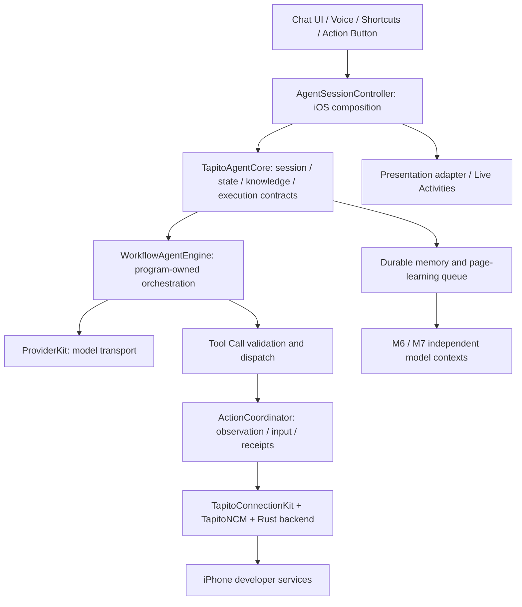

# Tapito

[简体中文](README.zh-CN.md) · English

**An iPhone assistant that turns natural-language tasks into verified device actions.** Tapito combines program-owned workflows, model tool calls, on-device screen recognition, reusable app skills and long-term memory.

The agent runtime, connection services, voice session and UI have separate boundaries. The current app uses an embedded local loopback VPN to access the iPhone's developer services; ordinary chat does not require a device-control connection.

## Current capabilities

- **Multiple entry points:** text, continuous voice, Shortcuts and an Action Button control. Live Activities show task state and provide an end-voice action. Automatic Dynamic Island expansion is controlled by iOS.
- **Program-owned execution:** task routing, context preparation, tool validation, serial dispatch, result checks and cancellation are implemented in code. Models participate in task understanding, unknown-page exploration, correction and response generation.
- **Local observation:** Vision OCR returns text candidates and coordinates. Ambiguous targets, icons and complex content can use visual model observation. Focused fields support whole-text input instead of tapping individual keyboard keys.
- **Reusable page capabilities:** learn stable UI labels, control bounds, functions and observed page transitions from actual runs. Reviewed capabilities use fresh local image checks and can avoid per-step OCR/model calls; changing pages or versions invalidate the fast path.
- **App-specific skills:** built-in guidance for Notes, Clock, WeChat, Weibo and QQ, plus the common iOS operation skill. These describe operating rules and verification; they are not pre-trained coordinate maps for every app version.
- **Persistent learning:** personal facts/preferences and page knowledge are separate. M6/M7 analysis runs through a durable asynchronous queue. Skill candidates are reviewed before activation; revisions can be disabled or deleted.
- **Independent connection services:** embedded `Tapito 本机连接` VPN, pairing integration and the bundled `Tapito 户外初始化` Shortcut. Outdoor initialization sequences offline connection setup and network restoration; it is not a universal cellular bypass.
- **Configurable models:** multiple providers, a default provider/model, OpenAI-compatible Chat Completions and selectable Responses transport. ChatGPT subscription integration is separate and has its own validation limits.
- **Explicit failures:** tool calls have receipts; protocol failures and unknown action outcomes stop execution without replaying inputs. Persistent diagnostics cover connection, model, execution and learning failures.

## Architecture



| Module | Responsibility |
| --- | --- |
| `ios-app/TapitoAgentKit` | UI-independent contracts, sessions, page/workflow execution, memory, learning queue and model orchestration |
| `ios-app/ProviderKit` | Provider contracts, protocol adapters and request/response handling |
| `ios-app/TapitoConnectionKit` | Connection configuration, loopback packet logic and outdoor initialization state machine |
| `ncm-dev/TapitoNCM` + `ncm-dev/rust` | Swift/C/Rust developer-service protocol backend: authentication, screen sessions and device input |
| `ios-app/TapitoVoiceKit` | Voice state machine and Apple audio adapters |
| `ios-app/Tapito` | iOS composition, device adapters, persistence, settings and chat presentation |
| `ios-app/TapitoLoopbackTunnel` | Embedded Network Extension for local packet reinjection |
| `ios-app/TapitoLiveActivity` | Live Activity and system control presentation |

The core does not import SwiftUI, UIKit, voice or VPN APIs. The iOS host still owns platform permissions and execution lifetime. Replacing the UI does not require rewriting the workflow engine or connection algorithms.

## Task execution and learning

1. **Prepare context in code:** current task identity, selected provider, relevant memory and fixed skill/capability revisions.
2. **M1 routes the task:** clarify missing input, answer a conversation, or select device work. Natural-language requests currently make one M1 request.
3. **Prepare device work in code:** resolve the installed app, load its skills and start the app when required. A current-screen task does not launch another app.
4. **Execute a reviewed sequence or explore:** known capabilities use current local page checks. Unknown pages start with local OCR; M2/M3 return tool calls. The program validates a complete batch, executes it serially and observes after input. There is no separate model round just to ask whether OCR is needed.
5. **Handle outcomes:** M4 corrects only eligible page deviations and the remaining work. Connection/protocol errors and uncertain input outcomes stop the task. Navigation can finish with a program response; dynamic content and business outcomes require current evidence and, when needed, M5 summarization.
6. **Learn asynchronously:** persist a job after completion; M6 proposes source-backed personal memory, while M7 annotates actual UI transition evidence. New page capabilities become executable after review.

Page knowledge stores **stable controls and page structure**, not chat messages, contact names, feed content, entered values or full screenshots. Saved coordinates alone never authorize a click. Sending, deleting, confirmation controls and non-search text fields still require the current task's semantic checks.

See [runtime contracts and validation](docs/Tapito-WORKFLOW-RUNTIME.md) and [the actual M1–M7 prompts](ios-app/TapitoAgentKit/Sources/TapitoAgentSwiftAgentKit/WorkflowPrompts.swift). Manage learned capabilities under **Settings → Memory & Learning → 页面功能、控件与学习记录**.

## Running on an iPhone

1. Use Xcode 27 and an iOS 27 device. Configure your own signing team for the app, Live Activity extension and packet-tunnel extension.
2. Enable Developer Mode, establish the app's pairing identity and prepare a matching developer disk image through Xcode. The embedded VPN does not replace those prerequisites.
3. Configure a provider and default model. A provider running on your Mac must be reachable from the phone; the phone's `127.0.0.1` is not the Mac.
4. In connection settings, add and start `Tapito 本机连接`, then verify the control connection. The VPN reinjects local traffic and does not use an external proxy node. It may replace another active VPN.
5. Grant microphone/speech permissions for voice entry and location authorization for the selected background execution mode. Task execution releases microphone/audio; it does not listen for interruptions. System suspension can still end execution.
6. Optionally bind **Tapito 语音任务** in Settings → Action Button → Controls, and import the bundled **Tapito 户外初始化** Shortcut for outdoor connection preparation.

The outdoor Shortcut controls airplane mode through system actions, establishes the control connection while offline, turns airplane mode off and checks recovery. If the Shortcut is interrupted, manually restore airplane mode. See [connection setup and limitations](docs/Tapito-CONNECTION.md).

## Build and test

Install Xcode 27 and Rust with `aarch64-apple-ios`; add `aarch64-apple-ios-sim` only if you need simulator builds. Swift and Rust dependencies are pinned in their lockfiles. The Xcode build phase builds the Rust backend for the selected platform.

```sh
rustup target add aarch64-apple-ios
python3 ios-app/scripts/generate_xcode_project.py

# Host tests for the agent module; no simulator or phone actions.
swift test --package-path ios-app/TapitoAgentKit \
  --scratch-path .build/AgentCoreTests

# Compile the app, extensions and XCTest targets; does not run or install them.
xcodebuild -project ios-app/Tapito.xcodeproj -scheme Tapito \
  -configuration Debug -sdk iphoneos -destination 'generic/platform=iOS' \
  -derivedDataPath .build/DeviceBuild \
  -clonedSourcePackagesDirPath .build/SourcePackages \
  CODE_SIGNING_ALLOWED=NO build-for-testing
```

For signed installation, select your team/device in Xcode. Re-sign the bundled Shortcut when changing the bundle ID, team or Intent parameters. See [iOS build and configuration](ios-app/README.md).

**Latest recorded validation, 2026-10-16:** 54 agent host tests passed; unsigned iPhoneOS `build-for-testing` passed. That round did not run iOS integration tests, install the app, invoke a real model or measure device speed. It does not establish full coverage of the five apps or guaranteed background/cellular reliability.

## Protocol origins and Tapito improvements

Tapito's iPhone control protocol layer **draws on and reuses [Actell](https://github.com/ja1chen/actell)**, including its pairing/authentication path, CoreDevice developer-service integration, screen streaming and touch/text input channel. The source baseline is `e701786d1686823f9ab60524e689e387b7c3b904`.

On that foundation, Tapito adds modular connection and voice services, an embedded local VPN and outdoor setup orchestration, on-device OCR with frame-aware targeting, program-owned agent execution, page/control capability learning, asynchronous long-term memory, default provider selection and lifecycle diagnostics. Existing application components and vendor adapters are also retained/adapted; the project does not claim that every file outside the protocol layer is original.

This repository starts from a new initial commit without importing the upstream Git graph. **Source attribution and license notices remain.** The combined source distribution retains GPL-3.0; vendored dependencies retain their own notices. See [LICENSE](LICENSE), [provenance](THIRD_PARTY.md), [iOS licenses](ios-app/Licenses/) and [protocol reuse records](docs/ncm-coredevice/REUSE.md).

Key dependencies include [SwiftAgentKit](https://github.com/ayman3000/SwiftAgentKit), [MacPaw/OpenAI](https://github.com/MacPaw/OpenAI), [MarkdownUI](https://github.com/gonzalezreal/swift-markdown-ui), and the [idevice](https://github.com/jkcoxson/idevice) backend adapted through [Device Hub](https://github.com/JaviSoto/device-hub-ios). [pymobiledevice3](https://github.com/doronz88/pymobiledevice3) supplies protocol references. [LocalDevVPN](https://github.com/jkcoxson/LocalDevVPN) is a loopback design/reference project; Tapito's packet-tunnel implementation is independent and does not copy its source.

Older ESP32/USB experiments and dated evidence remain under `firmware/`, `firmware-device/` and `archives/`. They are not the current architecture or current Tapito acceptance results.
