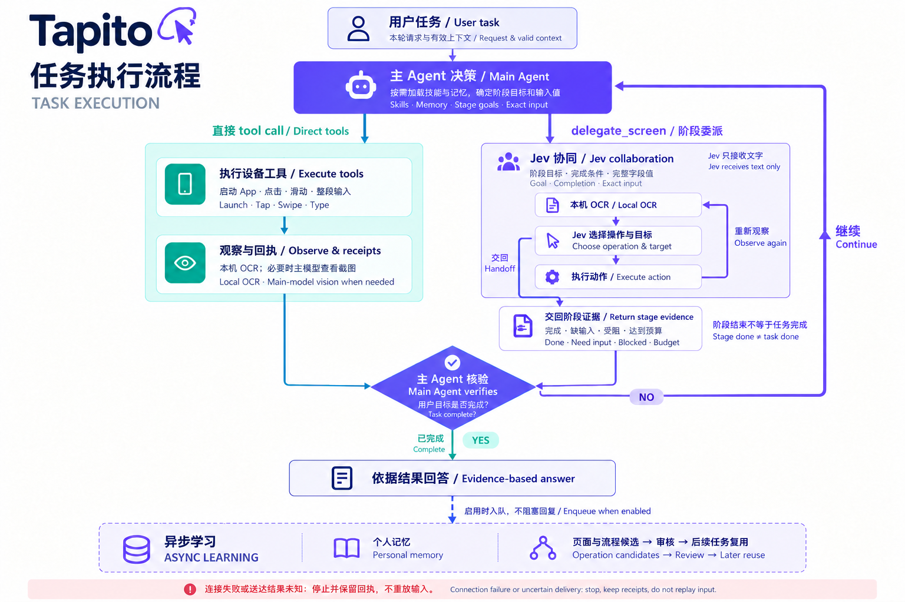
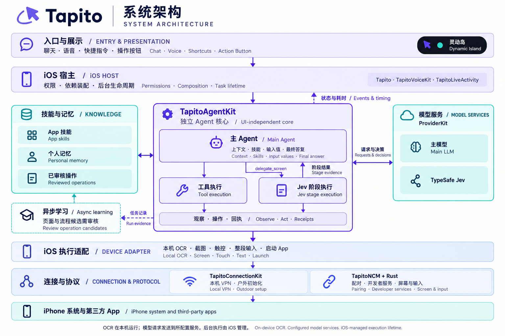

<p align="center">
  
</p>

<h1 align="center">Tapito</h1>
<p align="center"><strong>告诉 iPhone，你想做什么。</strong><br>用自然语言、技能与记忆，操作手机里的应用。</p>
<p align="center"><a href="README.md">English</a> · 简体中文</p>
<p align="center"><a href="#开始使用">开始使用</a> · <a href="#执行流程">执行流程</a> · <a href="#文档导航">文档导航</a> · <a href="CONTRIBUTING.md">参与贡献</a></p>

Tapito 把文字或语音请求变成真实 iPhone App 中的操作：观察页面、加载相关技能、调用设备工具，再核对结果。重复操作可以沉淀为可复用的页面知识和流程，有用的个人偏好可以形成长期记忆。

Agent 在 iPhone App 内运行，调用你配置的模型服务；设备操作通过内置回环 VPN 访问本机开发者服务。构建和首次准备需要 Mac，日常任务在手机上执行，前提是连接和 iOS 后台执行资格仍然有效。

> **当前使用方式：**面向 **iOS 27 / Xcode 27**，从源码构建。项目仍在持续开发，App 布局、模型决策和 iOS 生命周期都会影响任务结果；构建成功不代表所有应用流程均已验证。

## 可以尝试什么？

| 你可以这样说 | 任务涉及的操作 |
| --- | --- |
| “打开微博，告诉我第一条热搜是什么。” | 进入榜单，读取当前排名，依据页面内容回答。 |
| “新建一条备忘录，标题是出行清单，内容是充电器、证件、耳机。” | 打开备忘录、整段填写文字并核对保存结果。 |
| “设置一个工作日早上七点半的闹钟。” | 在时钟中核对时间、重复日期与启用状态。 |
| “在微信找到小明，发一句‘六点见’。” | 确认目标会话、填写消息，再核对发送结果。 |

以上是任务示例，不是兼容性或成功率测试结果。首次使用建议先完成一个读取任务，再尝试发送或修改数据。

### 操作演示

这里将补充真机录屏，展示读取信息、文字输入和已学习操作复用。拍摄内容及每段视频需要标明的信息见[录屏指南](docs/Tapito-DEMO-GUIDE.md)。

<!-- 完成录屏后，在这里嵌入 GitHub 上传的视频或带封面的链接，并保留设备、模型与耗时说明。 -->

## Tapito 的特点

- **从手机发起任务。** 支持聊天、语音、快捷指令和操作按钮入口；聊天记录与灵动岛展示简短步骤，并提供停止入口。
- **优先使用 OCR。** Apple Vision 在本机识别文字与位置；图标、复杂布局或状态无法通过文字判断时，再由主模型查看截图。输入框支持整段填写，无需逐字点击键盘。
- **按需加载 App 技能。** 内置备忘录、时钟、微信、微博、QQ 操作指南；其他已安装 App 也能使用通用 iOS 工具，不要求预先编写专属技能。
- **可查看的学习记录。** 个人记忆与页面控件、操作流程分开管理；学习到的操作候选经过审核后供后续任务使用。
- **UI、模型与执行解耦。** Agent、连接、语音和供应商各有独立模块；普通执行与 Jev 协同共用主 Agent。
- **每一步都有记录。** 模型请求和工具调用展示实际耗时，操作回执与持久化诊断区分模型决策、未发送动作和结果未知的操作。

## 开始使用

### 1. 准备环境

| 需要什么 | 用途 |
| --- | --- |
| 安装 Xcode 27 及命令行工具的 Mac | 构建、签名并安装主 App 和两个扩展。 |
| 运行 iOS 27 的真实 iPhone | 验证跨 App 画面读取与输入；模拟器不能证明这条真机连接可用。 |
| 支持 `packet-tunnel-provider` 的 Apple 签名配置 | 为主 App 与内置 VPN 扩展签署所需能力。 |
| Rust 工具链、Python 3 | 构建原生协议后端、生成 Xcode 工程。 |
| 手机能够访问的模型端点与凭据 | 模型需支持文本生成、工具调用；涉及截图的任务还需支持图片。 |

### 2. 构建并安装

```sh
git clone https://github.com/Y175/Tapito.git
cd Tapito
rustup target add aarch64-apple-ios
python3 ios-app/scripts/generate_xcode_project.py
open ios-app/Tapito.xcodeproj
```

在 Xcode 选择 **Tapito** scheme 和你的 iPhone，为 **Tapito**、**TapitoLiveActivity**、**TapitoLoopbackTunnel** 配置自己的签名团队与 Bundle ID，然后构建运行。修改生成工程中的设置后，重新生成工程前要同步到项目配置／生成器。Xcode 构建阶段会编译 Rust 后端。

开启开发者模式，通过 Xcode 准备匹配的开发者镜像，并完成 App 内的配对设置。安装成功不等于手机操控连接已建立；详细配置见 [iOS 指南](ios-app/README.md)。

### 3. 配置模型与手机连接

1. 在 **设置 → 供应商** 添加端点、凭据和模型，选择默认供应商／模型。支持 OpenAI 兼容的 Chat Completions，并可选择 Responses 协议。若服务部署在 Mac 上，请填写手机能访问的地址；手机上的 `127.0.0.1` 并不是 Mac。
2. 在 **设置 → 手机操控 → 连接与验证** 完成配对，批准添加 **Tapito 本机连接**，启动本机 VPN 并验证操控连接。
3. 先尝试“打开微博，查看热搜”等简单读取任务，核对执行记录与实际页面，再尝试较长流程。

内置 VPN 用于本机操控流量，不是互联网代理；已有的其他 VPN 可能与它冲突。普通聊天不需要建立手机操控连接。

### 4. 按需开启语音、操作按钮与户外初始化

- 语音输入需要麦克风与语音识别权限，所选后台模式需要相应定位授权。**任务执行期间释放麦克风与音频会话，不监听语音打断。** 语音聆听与结果播报是另外的阶段。
- 支持操作按钮的 iPhone，可在 **系统设置 → 操作按钮 → 控制** 选择 **Tapito 语音任务**。灵动岛是否展开、如何呈现动画由 iOS 控制。
- 在连接设置中导入内置的 **Tapito 户外初始化** 快捷指令。流程为准备会话 → 打开飞行模式 → 建立离线连接 → 关闭飞行模式 → 检查恢复。保留动作之间的输出变量绑定，无需手填初始化编号。

更换 Bundle ID、签名团队或 Intent 参数后，需要按自己的配置重新生成并签名快捷指令。户外初始化被中断时，请检查飞行模式是否已恢复。后台执行与户外连接仍受 iOS 和网络状态约束，详见[连接指南](docs/Tapito-CONNECTION.md)。

## 执行流程

**主模型掌握任务，程序执行工具并返回证据。** Tapito 使用 ReAct 式 tool call 循环，技能提供 App 知识，而不是限制可操作应用的名单。



1. 组合本轮请求、有效上下文、相关记忆与技能／工具目录。
2. 模型按需加载通用 iOS 技能和 App 引用文件，从已安装目录选择应用。
3. 串行执行工具并返回实际结果。页面变化后使用本机 OCR 观察；需要视觉证据时再请求截图。
4. 已审核的页面操作或流程通过当前页面检查后可以复用；不匹配时根据新页面规划剩余步骤。
5. 主 Agent 核对用户要求是否完成后回答。启用学习时，由异步队列处理本轮记录，不阻塞最终回复。

### 普通 Agent 与 Jev 协同有什么不同？

| 职责 | 普通 Agent | Jev 协同 |
| --- | --- | --- |
| 上下文、技能、记忆、选择 App、最终答复 | 主模型 | 同一套主 Agent，使用显式绑定的主模型 |
| 页面操作选择 | 主模型通过 tool call 决定 | 主 Agent 可委派阶段；Jev 从 OCR 选择操作与文字目标 |
| 输入框的准确内容 | 主模型决定 | 主模型提供完整字段值，Jev 选择填写时机 |
| 图片观察 | 主模型按需查看 | 主模型按需查看；**Jev 只接收文字** |
| 结束判断 | 主 Agent 核对完整任务 | Jev 交回阶段结果，由主 Agent 判断整个任务是否完成 |

使用 Jev 时，在供应商设置添加 **Jev 协同**，配置 TypeSafe 地址、Key 和模型，再明确选择 **主 Agent 供应商与模型**；随后在会话中选择该供应商。当前 Jev 入口接受文字任务，与普通模式共用技能、记忆和学习队列。[查看 Jev 配置、契约与提示词 →](docs/Tapito-JEV-OCR.md)

### 学习会沉淀什么？

**个人记忆**从用户表达中提取与任务有关、长期有效的事实或偏好。**操作知识**记录稳定的 UI 标签、控件范围、功能和实际观察到的页面跳转。两者独立存储和管理。

学习通过持久化异步队列处理。页面／流程候选经过审核后启用，作为对应 App 技能的引用供后续任务读取。管理入口为 **设置 → 记忆与学习 → 页面功能、控件与学习记录**。

匹配的已学习操作可通过本机图像检查，省去逐步 OCR 与模型调用，但仍需核对当前页面及版本。收件人身份、消息发送结果等动态事实需要当次确认；联系人、聊天正文、动态内容和输入值不作为页面模板复用。保存坐标不等于获得了适配所有版本的 App 地图。

## 系统架构



| 模块 | 职责 |
| --- | --- |
| [`TapitoAgentKit`](ios-app/TapitoAgentKit/) | 不依赖 UI 的会话、工具调度、页面／流程执行、记忆与学习 |
| [`ProviderKit`](ios-app/ProviderKit/) | 供应商契约与模型协议适配 |
| [`TapitoConnectionKit`](ios-app/TapitoConnectionKit/) | 连接配置、回环逻辑与户外初始化 |
| [`TapitoNCM`](ncm-dev/TapitoNCM/) + [`Rust 后端`](ncm-dev/rust/) | 配对认证、开发者服务、屏幕会话与设备输入 |
| [`TapitoVoiceKit`](ios-app/TapitoVoiceKit/) | 语音状态机与音频适配 |
| [`Tapito`](ios-app/Tapito/) | 平台装配、持久化、设置与聊天 UI |
| [`TapitoLoopbackTunnel`](ios-app/TapitoLoopbackTunnel/) | 内置本机 VPN 扩展 |
| [`TapitoLiveActivity`](ios-app/TapitoLiveActivity/) | 实时活动与系统控制入口 |

Agent 核心不依赖 SwiftUI、UIKit、语音或 VPN API。系统权限与后台生命周期由 iOS 宿主管理，后续更换 UI 可以继续使用已有 Agent 与连接契约。

## 数据与执行边界

- **本机识别不等于离线推理。** Vision OCR 在手机上运行；任务、相关上下文及所需屏幕文字会发送给已配置的模型服务。显式请求的截图交给支持图片的主模型，Jev 接收文字。
- **密钥与历史分开存储。** 供应商密钥保存在设备 Keychain，会话、学习记录与诊断文件分别保存。启用的异步学习也会调用所配置的主模型。
- **停止不会撤销已发生的操作。** 取消阻止后续工作；协议失败或输入送达结果未知时停止，不自动重放输入。
- **后台执行有系统限制。** 切到其他 App 不代表可以无限运行；iOS 可能暂停任务，Tapito 会报告中断，而不是宣称已经完成。
- **兼容性取决于具体任务。** 专属技能改善操作知识，但不保证每个版本都适配。纯图标等场景需要视觉观察；当前连接使用本机 VPN 回环，ESP32 与外部 HID 模块已移除。

## 常见问题

| 现象 | 优先检查 |
| --- | --- |
| 安装成功，却无法读取或操作手机 | 开发者模式、配对、开发者镜像与连接验证结果；安装成功不是连接测试。 |
| 手机连不上 Mac 上的模型服务 | 服务监听地址、手机到 Mac 的连通性与填写的 URL；不要在手机上使用 Mac 的 `localhost`。 |
| 目标 App 没有专属技能 | 仍可使用 `ios-operation` 和已安装 App 目录；仅因没有技能而拒绝执行，应作为问题反馈。 |
| 点击偏移或反复停留在同一页面 | 保存对应步骤、OCR／帧信息、App 版本和实际耗时，核对遮挡与布局变化。 |
| 切后台后任务停止 | 查看执行／生命周期错误；继续前先核对实际页面，避免重复已发生的操作。 |
| Jev 结束阶段但任务尚未完成 | 阶段结果应交回主 Agent；反馈时附上委派回执与后续主模型步骤。 |

可通过 [GitHub Issues](https://github.com/Y175/Tapito/issues) 反馈可复现的问题，信息格式见[贡献指南](CONTRIBUTING.md)。共享证据前请去除密钥、配对材料与个人屏幕内容。

## 开发与验证

安装前述依赖后，在仓库根目录执行：

```sh
# Agent 模块主机测试，不启动模拟器、不操作手机。
swift test --package-path ios-app/TapitoAgentKit \
  --scratch-path .build/AgentCoreTests

# OCR 目标选择检查。
bash ios-app/scripts/test_ocr_selection.sh

# 编译 App、扩展和 XCTest 目标，不执行测试、不安装。
xcodebuild -project ios-app/Tapito.xcodeproj -scheme Tapito \
  -configuration Debug -sdk iphoneos -destination 'generic/platform=iOS' \
  -derivedDataPath .build/DeviceBuild \
  -clonedSourcePackagesDirPath .build/SourcePackages \
  CODE_SIGNING_ALLOWED=NO build-for-testing
```

Swift 与 Rust 依赖使用锁文件固定版本。只有需要模拟器构建时，才添加 `aarch64-apple-ios-sim`。脚本模型测试验证调度契约；真实模型决策、真实 App 成功率和耗时需要真机证据。可查阅带日期的 [Jev 验证记录](docs/Tapito-JEV-OCR.md)和[运行时契约](docs/Tapito-WORKFLOW-RUNTIME.md)。

欢迎贡献 App 技能、可复现的真机案例、模型适配、无障碍体验和文档。修改执行契约或添加学习样本前，请阅读 [CONTRIBUTING.md](CONTRIBUTING.md)。

## 文档导航

| 文档 | 内容 |
| --- | --- |
| [iOS 使用与构建](ios-app/README.md) | 构建、签名与平台配置 |
| [连接能力](docs/Tapito-CONNECTION.md) | 配对、内置 VPN 与户外快捷指令 |
| [Agent 运行时](docs/Tapito-WORKFLOW-RUNTIME.md) | 工具调度、观察、学习与执行契约 |
| [Jev 协同](docs/Tapito-JEV-OCR.md) | 阶段委派、OCR 选择与准确输入 |
| [运行时提示词](ios-app/TapitoAgentKit/Sources/TapitoAgentSwiftAgentKit/WorkflowPrompts.swift) | 当前主 Agent 与学习提示词源码 |
| [内置技能](ios-app/Tapito/BuiltinSkills/) | 通用 iOS 操作与各 App 指南 |
| [录屏指南](docs/Tapito-DEMO-GUIDE.md) | 可复现的演示流程与发布说明 |
| [代码来源](THIRD_PARTY.md) | 上游代码与依赖声明 |

带日期的设计文档和 `archives/` 描述历史状态；当前行为以运行时文档和源码为准。

## 许可与致谢

Tapito 的 iPhone 操控协议层**复用并改进自 [Actell](https://github.com/ja1chen/actell)**，包括配对认证、CoreDevice 接入、屏幕流与触控／文字输入。来源基线为 `e701786d1686823f9ab60524e689e387b7c3b904`。保留的应用组件和供应商适配同样保留来源，Tapito 不宣称协议层之外的所有文件均为原创。

在此基础上，Tapito 增加了不依赖 UI 的 Agent Harness、独立连接与语音模块、内置 VPN／户外初始化、本机 OCR 与帧关联定位、App 技能、经审核的页面／流程学习、异步记忆和执行诊断。

当前组合分发采用 **GPL-3.0-only**，见 [LICENSE](LICENSE)；各源码和依赖的原有声明继续保留。详情见 [THIRD_PARTY.md](THIRD_PARTY.md)、[随附许可证](ios-app/Licenses/)及[协议复用记录](docs/ncm-coredevice/REUSE.md)。此前闭源版本的讨论保留为[历史记录](docs/Tapito-LICENSE-MIGRATION.md)，不再作为当前项目方向。

感谢 [SwiftAgentKit](https://github.com/ayman3000/SwiftAgentKit)、[MacPaw/OpenAI](https://github.com/MacPaw/OpenAI)、[MarkdownUI](https://github.com/gonzalezreal/swift-markdown-ui)、[idevice](https://github.com/jkcoxson/idevice)、[Device Hub](https://github.com/JaviSoto/device-hub-ios) 和 [pymobiledevice3](https://github.com/doronz88/pymobiledevice3)。[LocalDevVPN](https://github.com/jkcoxson/LocalDevVPN) 提供回环方案参考；Tapito 的隧道扩展为独立实现。
