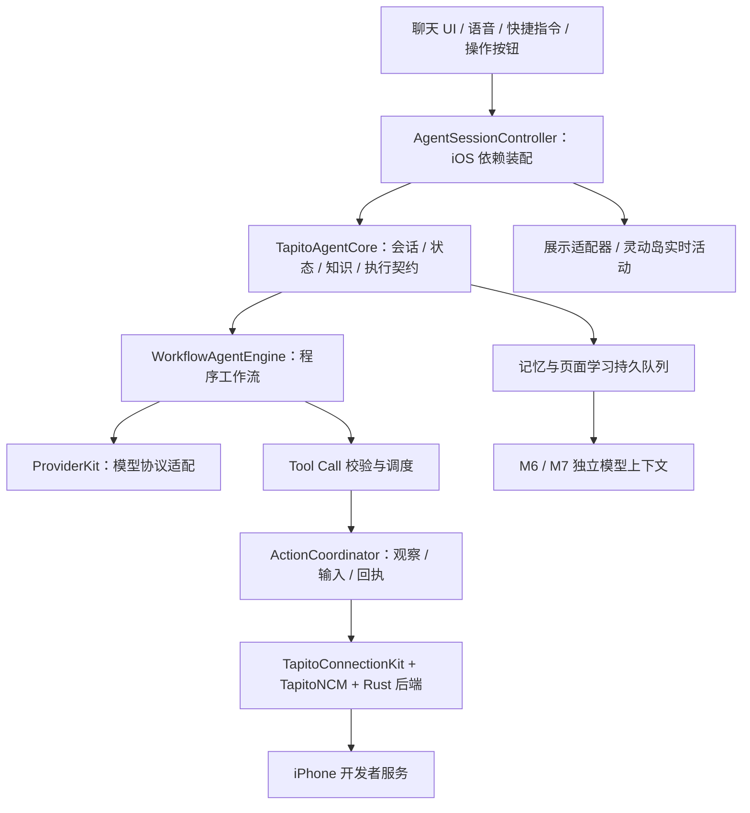

# Tapito

简体中文 · [English](README.md)

**把自然语言任务变成可核验的 iPhone 操作。** Tapito 将程序工作流、模型工具调用、本机屏幕识别、App 专属技能和长期记忆组合为手机助手。

Agent 核心、连接服务、语音会话和 UI 分别解耦。当前 App 通过内置本机回环 VPN 访问 iPhone 开发者服务；普通聊天无需连接手机操控通道。

## 当前能力

- **多种入口**：文字、连续语音、快捷指令和操作按钮控制；实时活动展示任务状态，并支持结束语音。灵动岛是否自动展开由 iOS 决定。
- **程序主导执行**：代码负责路由检查、上下文准备、工具校验、串行调度、结果核验和取消；模型负责理解任务、探索未知页面、纠错及整理回答。
- **本地观察与输入**：Vision OCR 生成文字候选及坐标；歧义目标、图标和复杂内容按需使用视觉模型。字段聚焦后可整段输入，不需要逐个点击键盘按键。
- **复用页面能力**：从实际运行中学习固定 UI 标签、控件位置、功能和页面变化。审核后通过当前画面的本机核验执行，减少逐步 OCR 和模型调用；页面或版本不匹配时退出快速路径。
- **App 专属技能**：内置备忘录、时钟、微信、微博、QQ 及通用 iOS 操作指导。技能包含操作规则与核验方式，不等于已经训练好所有 App 版本的按钮坐标。
- **持久化学习**：个人事实/偏好与页面知识独立保存；M6/M7 使用持久异步队列分析。技能候选经审核后启用，支持修订、停用和删除。
- **独立连接服务**：内置 `Tapito 本机连接` VPN、配对接入及 `Tapito 户外初始化` 快捷指令；编排离线建链和网络恢复，不宣称能普遍绕过所有蜂窝网络限制。
- **模型配置**：支持多个供应商、默认供应商/模型、OpenAI 兼容 Chat Completions 和可选 Responses 协议。ChatGPT 订阅接入为独立路径，有单独验证边界。
- **明确失败与诊断**：工具调用有执行回执；协议错误或动作结果未知时停止，不重复发送输入。连接、模型、执行和学习环节都有持久诊断记录。

## 当前架构



| 模块 | 职责 |
| --- | --- |
| `ios-app/TapitoAgentKit` | 不依赖 UI 的契约、会话、页面/流程执行、记忆、学习队列和模型编排 |
| `ios-app/ProviderKit` | 供应商契约、模型协议适配、请求与响应处理 |
| `ios-app/TapitoConnectionKit` | 连接配置、回环数据包处理、户外初始化状态机 |
| `ncm-dev/TapitoNCM` + `ncm-dev/rust` | Swift/C/Rust 开发者服务协议后端：认证、屏幕会话与设备输入 |
| `ios-app/TapitoVoiceKit` | 语音状态机和 Apple 音频适配 |
| `ios-app/Tapito` | iOS 依赖装配、设备适配、持久化、设置与聊天展示 |
| `ios-app/TapitoLoopbackTunnel` | 本机数据包回注的 Network Extension |
| `ios-app/TapitoLiveActivity` | 实时活动与系统控制展示 |

核心不依赖 SwiftUI、UIKit、语音或 VPN API；平台权限和运行资格由 iOS 宿主管理。后续重构 UI，无需重写工作流引擎或连接算法。

## 任务执行与学习流程

1. **程序准备上下文**：当前运行身份、选定模型、相关记忆、固定版本的技能和页面能力。
2. **M1 理解并路由任务**：缺少信息则澄清；普通聊天进入回答；手机操作进入设备流程。当前自然语言请求固定进行一次 M1 调用。
3. **程序准备设备任务**：解析已安装 App、装配专属技能、按需启动目标 App；当前屏幕任务不额外启动其他 App。
4. **复用已审核步骤或探索页面**：已知能力通过当前画面本机核验；未知页面先本地 OCR，M2/M3 返回 Tool Call。程序完整校验工具批次后串行执行，输入后重新观察；没有单独一轮“问模型是否需要 OCR”。
5. **处理结果与偏差**：M4 只处理允许纠正的页面偏差及剩余步骤；连接/协议错误和未知输入结果直接停止。导航完成可以程序回复；动态内容和业务结果需要当次证据，必要时由 M5 整理。
6. **异步沉淀**：任务完成后先入队；M6 根据用户原话整理个人记忆，M7 标注实际 UI 操作证据。新页面能力审核后才用于执行。

页面知识保存的是**固定控件和页面结构**，不把聊天消息、联系人姓名、信息流正文、输入值或完整截图写入模板。旧坐标不能直接授权点击；发送、删除、确认及非搜索字段输入仍需结合当前任务核实。

详见[运行契约与验证](docs/Tapito-WORKFLOW-RUNTIME.md)、[实际 M1–M7 提示词](ios-app/TapitoAgentKit/Sources/TapitoAgentSwiftAgentKit/WorkflowPrompts.swift)。管理入口：**设置 → 记忆与学习 → 页面功能、控件与学习记录**。

## 真机使用

1. 使用 Xcode 27 和 iOS 27 设备，为主 App、实时活动扩展和 packet-tunnel 扩展配置自己的签名团队。
2. 开启开发者模式，在 App 中建立配对身份，并通过 Xcode 准备匹配的开发者磁盘映像。内置 VPN 不代替首次配对和开发环境准备。
3. 配置模型供应商及默认模型。Mac 上的代理必须能被手机访问；手机的 `127.0.0.1` 并不指向 Mac。
4. 在连接设置中添加并启动 `Tapito 本机连接`，核验操控连接。它只回注本机流量，不连接外部代理节点；可能替换当前运行的其他 VPN。
5. 语音入口需要麦克风/语音识别授权；选用定位后台执行方案时需要对应定位授权。任务执行期间释放麦克风和音频，不做语音打断；系统仍可能暂停或结束执行。
6. 按需在“设置 → 操作按钮 → 控制”绑定 **Tapito 语音任务**，并导入随 App 提供的 **Tapito 户外初始化** 快捷指令。

户外快捷指令通过系统动作打开飞行模式、离线建立操控连接、关闭飞行模式并检查恢复；如果中途被停止，需要手动恢复飞行模式。具体条件见[连接配置与限制](docs/Tapito-CONNECTION.md)。

## 构建与测试

需要 Xcode 27、Rust 和 `aarch64-apple-ios` 编译目标；仅需模拟器构建时再添加 `aarch64-apple-ios-sim`。Swift/Rust 依赖由锁文件固定；Xcode 构建阶段会生成对应平台的 Rust 后端。

```sh
rustup target add aarch64-apple-ios
python3 ios-app/scripts/generate_xcode_project.py

# Agent 模块主机测试，不启动模拟器、不操作手机。
swift test --package-path ios-app/TapitoAgentKit \
  --scratch-path .build/AgentCoreTests

# 编译 App、扩展及 XCTest 目标，不运行测试、不安装。
xcodebuild -project ios-app/Tapito.xcodeproj -scheme Tapito \
  -configuration Debug -sdk iphoneos -destination 'generic/platform=iOS' \
  -derivedDataPath .build/DeviceBuild \
  -clonedSourcePackagesDirPath .build/SourcePackages \
  CODE_SIGNING_ALLOWED=NO build-for-testing
```

签名安装需在 Xcode 选择自己的团队和设备；改变 Bundle ID、团队或 Intent 参数时，需要重新签名内置快捷指令。详见 [iOS 构建与配置](ios-app/README.md)。

**最近记录的验证（2026-10-16）**：54 项 Agent 主机测试通过；无签名 iPhoneOS `build-for-testing` 通过。该轮未执行 iOS 集成测试、安装、真实模型调用或真机耗时测量；不代表五个 App 的全部流程已沉淀，也不保证所有后台或蜂窝网络环境都可用。

## 协议来源与 Tapito 的优化

Tapito 的 iPhone 控制协议层**借鉴并复用了 [Actell 原工程](https://github.com/ja1chen/actell)** 的配对认证、CoreDevice 开发者服务接入、屏幕流及触控/文本输入通道。源码来源基线为 `e701786d1686823f9ab60524e689e387b7c3b904`。

在此基础上，Tapito 新增或重构了：连接与语音模块解耦、内置本机 VPN 与户外初始化、带当前帧校验的本地 OCR、程序主导 Agent 工作流、页面控件能力学习、异步长期记忆、默认供应商选择和生命周期诊断。工程还保留并适配了部分应用组件及第三方适配层，不将协议层以外的所有文件宣称为独立原创。

本仓库从全新初始提交开始，不导入上游 Git 提交图；**源码署名与许可声明继续保留**。组合源码沿用 GPL-3.0，第三方依赖保留各自声明。详见 [LICENSE](LICENSE)、[来源说明](THIRD_PARTY.md)、[iOS 许可证](ios-app/Licenses/)及[协议复用记录](docs/ncm-coredevice/REUSE.md)。

主要依赖包括 [SwiftAgentKit](https://github.com/ayman3000/SwiftAgentKit)、[MacPaw/OpenAI](https://github.com/MacPaw/OpenAI)、[MarkdownUI](https://github.com/gonzalezreal/swift-markdown-ui)，以及经 [Device Hub](https://github.com/JaviSoto/device-hub-ios) 适配的 [idevice](https://github.com/jkcoxson/idevice) 后端；[pymobiledevice3](https://github.com/doronz88/pymobiledevice3) 提供协议参考。[LocalDevVPN](https://github.com/jkcoxson/LocalDevVPN) 是回环方案的设计/验证参考，Tapito 的 packet-tunnel 为独立实现，未复制其源码。

`firmware/`、`firmware-device/` 和 `archives/` 中保留的 ESP32/USB 实验与带日期的材料属于参考资料，不作为当前架构或 Tapito 当前验收结论。
