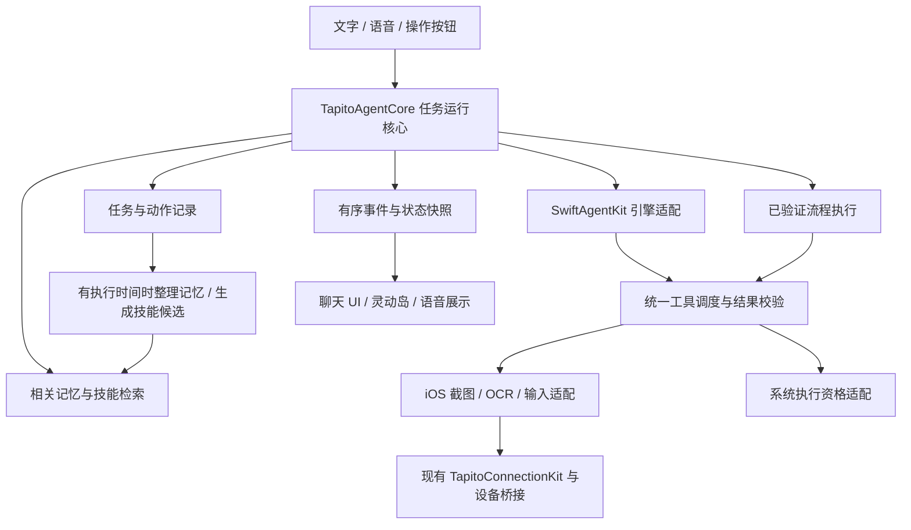

# Tapito Agent 解耦、长期记忆与技能学习方案

> 后续实现已落地，当前模块与验证见 [Tapito Agent 模块](Tapito-AGENT.md)。下文保留调研时的源码路径和方案；原 AgentViewModel 已更名为 AgentSessionController。

调研日期：2026-10-15（Asia/Shanghai）。状态：源码核查与设计建议，尚未实现本文件提出的新模块。

## 1. 建议结论

保留当前 SwiftAgentKit 推理引擎和已工作的设备连接，新增独立 Swift 包 `TapitoAgentKit`。由它管理任务、会话、工具调度、记忆和技能版本；App 负责界面、语音、灵动岛与系统运行资格。第一阶段使用一个执行 Agent，同一手机的界面操作串行，不引入多个执行 Agent 抢占屏幕。

长期记忆采用本机优先的结构化存储；常用操作采用“有参数、有页面条件、有结果检查”的技能流程；自学习通过执行证据生成候选版本，验证后再启用。学习发生在数据和技能层，不让模型修改 App 二进制、连接协议或授权规则。

这份方案综合了下面的公开案例与当前源码，属于 Tapito 的工程建议；没有把论文的成功率或提速结果当作 Tapito 已验证指标。

## 2. 当前代码的真实起点

以下路径相对仓库根目录，行号对应本次调研时工作区。

| 现状 | 源码证据 | 重构含义 |
| --- | --- | --- |
| `AgentViewModel` 共 1,174 行，同时持有任务、供应商、工具、会话、后台状态、灵动岛与语音协作状态 | `ios-app/Tapito/Agent/AgentViewModel.swift:13`；Agent 与工具装配在 `:667` | 需要抽出运行责任，不能只移动文件或改类名 |
| 每轮新建 SwiftAgentKit `Agent`，装配设备工具和 `load_skill`；当前未调用记忆/自学习存储的挂接接口 | `AgentViewModel.swift:675`、`:693`；检索 App 源码未发现 `setMemoryStore` / `setSkillStore` 接入 | 现在的聊天历史和技能导入，不等于跨会话长期记忆和自动学习 |
| 当前上下文取同一会话最近 16 条已完成用户/助手消息 | `ios-app/Tapito/Storage/ConversationStore.swift:266` | 新会话需要独立的记忆检索；不能把所有历史拼入提示词 |
| 技能有内容哈希、运行期快照、启用/导入/删除；内置只有 `ios-operation` 及两篇参考文档 | `ios-app/Tapito/Storage/SkillStore.swift:52`、`:65`、`:96` | 这些校验应保留；还没有微信、微博、QQ、备忘录等专属流程执行器 |
| 底层已提供 `AgentMemoryStore`、`setMemoryStore`、`setSkillStore` | `ios-app/Vendor/SwiftAgentKit/Sources/SwiftAgentKit/Memory/AgentMemoryStore.swift:82`；`Core/Agent.swift:575` | 可以借用接口思想，但 App 需要自己的记忆生命周期与数据合同 |
| 底层 `LearnSkillTool` 保存后立即替换同名技能并注册到运行中 | `ios-app/Vendor/SwiftAgentKit/Sources/SwiftAgentKit/Tools/LearnSkillTool.swift:73` | 不直接启用该行为；它缺少本项目需要的候选、验证、发布和运行版本冻结 |
| 已有 OCR 帧标识、候选验证、截图复用和输入后失效机制 | `ios-app/Tapito/Agent/DeviceTools.swift:104`、`:124`、`:200` | 技能必须复用现有安全执行通道，不能绕过检查直接播放历史坐标 |
| 已有工具投递状态和任务检查点 | `ios-app/Tapito/Background/RunLifecycleCoordinator.swift:13`、`:230` | 保留 `dispatching / acknowledged / observedResult / outcomeUnknown`，不能把“恢复记忆”当作“可以重发动作” |
| 已拆出连接与语音包，但 App 总运行对象仍持有 ViewModel | `ios-app/Tapito/SessionCommands/TapitoRuntime.swift:4`；`TapitoConnectionKit/Package.swift`；`TapitoVoiceKit/Package.swift` | 新核心由组合入口创建，UI、语音、Intent 只调用统一入口 |

本机 `ticket-agent` 也重新核查过：`ticket-ai/ticket-agent/pom.xml:20` 为 AgentScope 2.0.2；`agent/harness/HarnessAgentService.java:543` 分别注入模型、工具、技能仓库、状态与记忆；`service/HarnessMemoryRevisionStore.java:40` 通过版本比较保护人工修改。值得借鉴的是装配边界与版本保护，无需把 Java 服务端或 Redis/Mongo 搬进 iPhone。源码根目录：`/Users/y175/code/temp/OnlineTicketBookingSystem`。

## 3. 网上有哪些值得借鉴的案例

### AgentScope Java：运行框架、技能与记忆分别装配

官方当前 Workspace 文档把静态配置、运行状态和长期记忆区分为不同生命周期；技能可按包组织，执行检查点不与普通工作区文件混为一体。适合借鉴到 Tapito 的是运行核心与外围服务的边界。线上 main 文档会演进，不能当作本地 2.0.2 的精确 API 合同。[官方 Workspace 文档](https://github.com/agentscope-ai/agentscope-java/blob/main/docs/v2/en/docs/harness/workspace.md)

### LangGraph / LangMem：会话状态和跨会话记忆分开

LangGraph 区分线程检查点与跨会话 Store，并介绍事实、经历、程序性记忆；LangMem 提供记忆提取及根据反馈优化指令的机制。对 Tapito 的启发是：不同信息分别存、按任务检索，日常提炼不必阻塞每一个工具步骤。[LangGraph Memory](https://docs.langchain.com/oss/python/concepts/memory)、[LangMem Concepts](https://langchain-ai.github.io/langmem/concepts/conceptual_guide/)

### Letta：助手具有持续身份，细节按需读取

当前 Agent SDK 文档介绍常驻上下文与按需读取的记忆，以及通过 Dreaming 整理近期会话。文档中的云端记忆仓库和后台子 Agent 是它自身运行环境的能力。Tapito 借鉴“少量稳定信息常驻、其余按需读取、独立整理”的思想，不把服务器后台执行等同于 iOS 后台权限，也不在首版引入 Git 同步。[Letta Memory](https://docs.letta.com/agent-sdk/memory)

### Mem0：记忆提取可以成为独立服务

官方文档将从对话提取事实、按身份范围保存和后续检索独立出来；本次读到的 Add 文档描述追加式存储，因此不能假定一次 `add` 就解决冲突、纠正和删除。Tapito 可以采用独立记忆服务边界，首版不必接入托管平台。[Mem0 Add Memory](https://docs.mem0.ai/core-concepts/memory-operations/add)

### AppAgent / AppAgentX：最接近“常用 App 越用越熟”

AppAgent 从探索或人类示范形成应用知识；AppAgentX 进一步从历史轨迹识别重复操作序列，组织成高层动作，减少重复逐步推理。这最贴近用户提出的 App 专属流程。它们的公开运行方式依赖 Android / ADB，属于可借鉴的学习方法，不能直接安装进 Tapito。[AppAgent 官方仓库](https://github.com/TencentQQGYLab/AppAgent)、[AppAgentX 项目与方法](https://appagentx.github.io/)、[AppAgentX 实现](https://github.com/Westlake-AGI-Lab/AppAgentX)

### Agent S：检索经验辅助规划

论文展示了在任务和子任务规划中检索历史经验的方式。Tapito 可借鉴任务分解与经验召回，但无需首版就引入多 Agent；它的桌面基准结果也不代表 iPhone 表现。[Agent S 原论文](https://arxiv.org/abs/2410.08164)

### Open-AutoGLM：iOS 执行通道仍需单独解决

官方 iOS 指南使用 WebDriverAgent，并要求 Mac/Xcode、设备以及 USB 或同一 Wi-Fi。它是手机操作框架的参考，不能证明已有方案支持 Tapito 的“纯手机、户外 5G、本机运行”。因此本次不替换已经开发的连接层。[官方 iOS 配置指南](https://github.com/zai-org/Open-AutoGLM/blob/main/docs/ios_setup/ios_setup.md)

## 4. 模块边界：一个包，先两个 target

建议包路径 `ios-app/TapitoAgentKit`，首版只建立必要的两个 target，避免拆成大量微型包：

- `TapitoAgentCore`：Foundation 数据合同、任务状态机、事件、工具端口、记忆、技能、运行记录。不引用 SwiftUI、ActivityKit、CoreLocation、AVFoundation 或连接 SDK。
- `TapitoAgentSwiftAgentKit`：现有引擎适配与 ProviderCore 对接。SwiftAgentKit 的消息/工具/事件类型只在这一层转换，不暴露到 UI。

SQLite 存储实现可以先放在包内独立目录；只有依赖确实需要隔离时才新增存储 target。iOS 截图、OCR、输入、VPN 和系统执行资格的适配器留在 App 内。



最小合同：

| 合同 | 负责的事 | 重要约束 |
| --- | --- | --- |
| `AssistantRuntime` | 提交、停止、查询任务；显式继续暂停任务 | 每次分配 `conversationID / runID / generation`；新会话不会接管旧任务 |
| `AgentEngine` | 模型推理与流式事件转换 | 不拥有设备权限，不自行保存个人画像 |
| `ToolExecutor` | 调用已注册工具并返回类型化回执 | 引擎和流程执行器必须走同一入口；设备写操作串行 |
| `ExecutionLease` | 报告系统当前允许执行的状态 | 由 App 实现；持久化任务不代表获得执行时间 |
| `RunRepository` | 动作记录、任务检查点、执行事件 | 写入失败显式阻止尚未投递的动作，不默默继续 |
| `MemoryRepository` | 查询、保存、纠正、删除及版本检查 | 不是聊天记录仓库，也不授予执行权限 |
| `SkillRepository` | 检索技能、固定版本、发布和回退 | 一轮任务固定 revision，运行中不被学习任务改写 |

`AgentViewModel` 最终只投影状态和发送命令。后台运行资格失效由运行核心接收明确事件并停在安全边界；不能因为把运行代码抽成 `actor` 或 Package 就声称可以无限后台运行。

## 5. 长期记忆应该记住什么

| 类别 | 示例 | 生命周期 / 使用方式 |
| --- | --- | --- |
| 当前任务状态 | 正在创建采购清单；已输入但尚未确认保存 | 运行记录与检查点，单独保存；不能当作用户长期偏好 |
| 个人事实与偏好 | 用户明确说默认用备忘录记录采购清单；希望答复简短 | 跨会话；记录来源、范围、更新时间和有效状态 |
| 任务经历 | 某次清单已创建，保存位置与结果证据 | 支持“接着上次”；必须重新核实外部对象当前状态 |
| 操作技能 | 备忘录创建清单、微博查看热搜、微信查找联系人 | App 与任务范围内复用；具有版本与适用条件 |

实时热搜、临时页面内容、模型猜测、未验证成功的动作，不直接成为长期事实。用户某次说“这次用 QQ”，也不自动改成“以后默认用 QQ”。账号密钥仍只进入现有 SecretStore，不进入可检索的记忆。

建议每条记忆至少包含：

```text
id, namespace, kind, subject, content
sourceType, sourceRefs(messageID/runID/toolReceiptID), evidenceSummary
createdAt, updatedAt, lastVerifiedAt, expiresAt?
status(candidate/active/superseded/deleted), revision, supersedes?
userEdited, sensitivity, allowedUses
```

`namespace` 首版使用本机用户档案与任务/App 范围；不凭空引入多租户服务。以后若有账号同步再增加明确身份映射。供应商选择不改变用户身份，但要明确哪些记忆可以随请求发送给该供应商。

### 写入与纠正

1. “记住我……”是显式写入指令：完成持久化再回复已记住；失败要明确告知。
2. 一般对话自动提炼偏好时，必须引用用户原话；不从助手自己生成的答复反推用户事实。
3. “这次”形成任务局部覆盖；“以后改成”更新长期条目；范围或主体不明确时保留冲突，不能用最新时间强行覆盖所有同类内容。
4. 用户手工修改优先于旧模型快照。采用事务和版本比较，旧整理作业不能覆盖刚刚纠正的记忆；这与本机 `ticket-agent` 的版本保护思想一致。
5. 运行结束先保存客观结果，较重的归纳单独排队。记忆整理失败只报告记忆未更新，不能把已经成功的设备动作改成失败，更不能重做动作。

### 检索与遗忘

- 每轮先解析任务、目标 App 和明确实体，再按范围、有效性和来源筛选，最后排序；只注入与当前任务有关的少量条目。
- 首版采用 SQLite 事务、结构化过滤与文本检索。中文检索需要专门覆盖分词/别名，不能假定默认英文分词足够。embedding 接口作为后续可选能力，先验证召回质量再决定是否增加模型和索引。
- 记忆是带来源的参考数据，不作为最高优先级指令。OCR、网页、聊天内容不能通过“记住这段话”偷偷修改用户偏好或工具权限。
- 用户可查看“记住了什么、何时记住、来自哪里、最近用在哪次任务”，并编辑、删除、暂停自动记忆，或发起不写入长期记忆的临时任务。
- 删除同时移除检索索引、缓存和派生摘要中的相应内容，取消旧提炼任务；保留不含原文的必要删除版本标记，防止旧作业把内容复活。重新处理旧聊天时也必须遵守删除边界。
- 本机保存不等于完全离线：被选中的记忆仍可能随任务发送给当前模型供应商。应支持关闭自动记忆及按条目限制用途，普通诊断日志不记录记忆原文。

## 6. App 专属技能：从说明书升级为可验证流程

保留 Markdown 说明，增加经过 schema 校验的声明式流程；不下载或执行任意脚本。当前技能导入器仅接受 Markdown/TXT，结构化流程需要显式扩展验证器，不假装现有导入功能已经支持。

一个技能包建议包含：

```text
notes-create-list/
  SKILL.md          用途、何时使用、边界
  manifest.json     技能 ID、版本、目标 App、适用条件、能力需求
  workflows.json    输入参数、页面前提、操作、预期结果
  fixtures/         脱敏 OCR 与页面特征测试数据
```

注册工具仍由 App 编译代码提供；技能只能引用工具目录中的已知能力。未支持的工具、未知流程版本、缺失参数必须明确失败。

定位顺序建议：已验证的系统能力或深链 → 当前页面的文字/语义锚点 → 经重新定位的视觉元素 → 与当前画面验证一致的坐标。深链只负责它被验证支持的功能，不把“能启动 App”当成“能完成任务”。

坐标缓存必须绑定 App、已验证版本、页面结构、方向、屏幕几何、显示布局条件；归一化坐标也只是提示，不是永久地址。App 版本或页面结构变化时停止快路径，重新识别并记录原因。

**现有工具约束要保留：**`tap_text` 必须使用当前 `frame_id/candidate_id`，普通 `tap` 必须来自已观察的画面。首版学到的坐标不能绕过这些约束。未来若要无视觉模型的本地模板匹配点击，需要独立的证据验证工具与测试，不能直接复用旧坐标冒充新帧结果。

例如“在备忘录创建今晚的采购清单”：

1. 按目标 App 和任务类型选技能，读取用户已确认的默认保存偏好。
2. 启动 App，验证当前页面；如果有弹窗，先明确处理页面变化。
3. 定位新建入口，进入编辑状态，聚焦输入位置。
4. 使用现有 `type_text` 整段输入，避免逐字点击软键盘；这不意味着任何未聚焦输入框都能被直接改写。
5. 核对标题、内容和保存状态；只在有足够观察证据时记为成功。
6. 保存任务回执，再生成可以复用的经验候选。

### 第一批技能范围

| App / 能力 | 首批任务 | 注意 |
| --- | --- | --- |
| 备忘录 | 新建、查找、追加清单 | 先使用现有 GUI 通道；不预设任意 Apple Notes 写入 API 已可用 |
| 时钟 | 查找/创建/调整系统时钟中的闹钟 | 当前按 GUI 技能验证；AlarmKit 创建本 App 闹钟不能当作已修改系统时钟闹钟 |
| 提醒事项 / 日历 | 新建与查询 | 可评估 EventKit，在系统授权及回读验证后优先使用结构化能力 |
| 微博 | 查看热搜、搜索内容 | 先做读取任务；发评论单独设计结果核查，未知结果不自动重发 |
| 微信 / QQ | 找联系人、打开会话、准备或发送指定文本 | 同名对象需辨认；不能因历史偏好就默认收件人或获得新的发送授权 |

官方 EventKit 支持日历与提醒事项数据访问；AlarmKit 用于应用自身的闹钟和计时器。它们不是所有系统 App 的统一读写接口。[EventKit](https://developer.apple.com/documentation/eventkit)、[AlarmKit](https://developer.apple.com/documentation/alarmkit)

## 7. 自学习、自更新如何闭环

```text
执行产生的观察、动作、结果与用户纠正
  → 去除个人内容、抽取参数和页面锚点
  → 形成候选技能版本
  → schema / 能力 / 授权边界检查
  → 用脱敏轨迹回放验证定位和预期结果
  → 在后续已授权任务中验证，不额外操作手机来练习
  → 发布版本，下一轮启用
  → 发现不匹配则停用相关快路径；有兼容证据时回退版本
```

训练数据包括动作类型、可解释的目的、前后观察、工具回执和用户纠正；不依赖模型私有思考内容。

不要以“调用三次就学会”作为唯一标准。一次成功可以产生候选；启用要看多次独立任务的结果证据、页面匹配与失败率。次数阈值应在实际任务集上校准，不宣称存在通用标准。

失败要分开处理：

| 失败类型 | 处理 |
| --- | --- |
| 页面布局/入口改变 | 退出快路径，重新观察和规划；成功后产生修订候选 |
| OCR 没有文字、多个同名目标、纯图标 | 明确转视觉观察，沿用当前帧；不是连接失败 |
| VPN、截图协议或执行资格失败 | 停止受影响操作，返回真实原因；不能换模型掩盖，也不改技能坐标 |
| 动作已发送、结果未知 | 只允许核查结果；禁止自动重复发送、发布或创建对象 |
| 模型最终说成功，但缺少结果证据 | 记为未验证；不提升技能可信度 |
| 整理作业版本冲突、存储损坏 | 明确报告，保留现有有效数据；不能清空后重建假装正常 |

内置技能不可被学习过程原地覆盖；学习产生独立修订并记录 base revision。学习版本不能扩大权限、取消结果检查或改写停止规则。已有用户授权无需重复索要，但过去某次授权不自动成为所有未来任务的授权。

## 8. iPhone 上的“长期助手”不等于后台常驻

记忆与待处理的整理作业必须持久化，即使进程退出也存在。整理可以在当前有执行资格的任务结束阶段、下次进入 App 或下一次合法运行窗口处理。系统不给时间就保持待处理，不假装已学习完成。

本次重构保留当前用户选定的后台方案，仅把其状态通过 `ExecutionLease` 接入。Letta/AgentScope 的服务器后台作业不能直接变成 iOS 的持续执行保证；Apple 的后台任务有各自调度与到期机制。[Apple Background Strategies](https://developer.apple.com/documentation/backgroundtasks/choosing-background-strategies-for-your-app)、[BGTask](https://developer.apple.com/documentation/backgroundtasks/bgtask)

“每天主动做某件事”还需要单独的调度、系统唤醒与授权设计。存一条偏好或待办不能代替真正的系统提醒/定时任务，更不能承诺任意时间后台操控其他 App。

## 9. 落地顺序与验收

| 阶段 | 交付 | 验收条件 |
| --- | --- | --- |
| P0：固定行为基线 | 脱敏任务轨迹、工具回执、停止与恢复用例、性能计数 | 记录当前版本成功/失败，能区分协议、识别、推理、投递错误 |
| P1：运行核心解耦 | 两个 target；UI/语音/Intent 共用核心；App 系统适配器 | 不依赖 SwiftUI 的核心测试可运行；原有授权、停止、设备串行与未知结果不重放测试保持通过 |
| P2：长期记忆首版 | 个人偏好、任务回执、检索、纠正、删除、记忆管理入口 | 重启和新会话可召回；纠正即时生效；旧作业不能复活被删除内容；其他页面文字不能污染画像 |
| P3：专属技能 | 先备忘录与微博读取流程，再时钟、微信、QQ | 验证前提和结果；页面变化退出快路径；支持批量输入；失败不误记成功 |
| P4：学习闭环 | 候选修订、轨迹评估、受控启用、停用/回退 | 发布有来源；运行版本固定；一次偶发失败不会破坏已有技能；没有学习引起的额外外部操作 |

第一批具体测试用例：

- 旧运行已经取消后，迟到的模型/工具回调不能启动下一次点击。
- 动作发送后崩溃，恢复后保留 `outcomeUnknown`；不得把它改成未执行并重发。
- 两个会话同时请求控制同一手机，只能按既有设备互斥规则运行。
- 已成功完成任务，但记忆整理失败：任务仍成功，记忆错误独立显示。
- 用户把默认保存位置从 A 改为 B，旧提炼结果不能改回 A。
- 删除偏好后，旧对话重提炼、索引缓存、摘要中均不能重新注入它。
- 页面里出现伪造“系统指令/永久记忆”文本，不进入用户偏好或授权记录。
- 相同文字出现在两个控件、键盘显示、方向变化、App 更新等情况，不能使用旧坐标。
- 文字任务无关个人记忆时不发送该记忆；临时任务不写入长期记忆。
- “已有候选技能”与“已验证技能”在结果中明确区分。

效果比较必须使用同一供应商、同一任务集与相同网络条件，记录任务成功率、错误点击/重复输入、模型轮数、图片上传量、端到端中位数/P95、技能命中率以及纠正/删除后的记忆准确性。核心逻辑先用可重复的本机测试，真实 App 操作再做范围明确的真机验收。

首版不加入：强制云端记忆服务、知识图谱、多 Agent 同时操作设备、任意脚本执行、直接覆盖正在运行的技能、把每次聊天都全文加入提示词。需要这些能力时再用实际问题证明其必要性。

## 10. 本次交付边界

已完成：当前源码核查、官方案例调研、模块合同、长期记忆策略、App 技能与学习闭环设计、实施顺序与验收清单。

尚未实施：`TapitoAgentKit`、长期记忆数据库、专属流程执行器、技能自动发布。此次没有改运行代码，没有构建、安装或执行手机任务。
