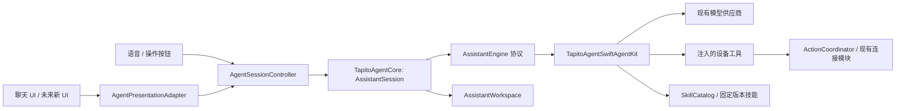
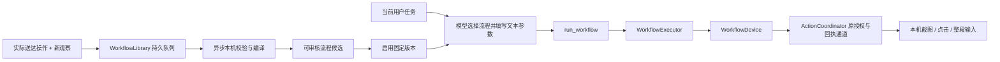

# Tapito Agent 模块

> 2026-10-16 实现更新：正式 live 入口已接入程序工作流。当前可执行契约、实际提示词和验证边界以 [运行实现](Tapito-WORKFLOW-RUNTIME.md) 为准；下文的早期设计示例和分阶段记录保留作背景。

2026-10-15 实现。这里描述当前代码能力；设计调研见 [架构研究](Tapito-AGENT-ARCHITECTURE-RESEARCH.md)。本轮没有安装、启动模拟器或执行手机任务。

## 模块边界



- `ios-app/TapitoAgentKit/Sources/TapitoAgentCore`：运行状态与取消隔离、模型无关事件、持久记忆、技能文档验证、分页和修订快照。不导入 SwiftUI/UIKit、ActivityKit、AVFoundation、CoreLocation、SwiftAgentKit 或连接模块。
- `TapitoAgentSwiftAgentKit`：现有引擎适配、历史投影、事件转换、有序消费、工具回执、记忆与学习工具。更换引擎时实现 `AssistantEngine`，UI 不消费引擎内部类型。
- `AgentSessionController`（原 AgentViewModel）：iOS 装配、设备/后台授权生命周期、会话存储与活动状态。保留这些平台职责，避免与此次记忆重构一起改动已验证的连接/后台机制。它仍依赖供应商和工具 SDK 的装配类型，尚不是跨平台宿主。
- `AgentPresentationAdapter`：把中立事件投影到会话展示。未来新 UI 可替换这一层；声音、连接与后台能力不放入 Agent 核心包。
- `AssistantMemoryView`：设置下的“记忆与学习”，只调用核心 API，不实现记忆提取或技能执行。

## 本轮交付

1. 实际模型循环已从原 ViewModel 移到 `SwiftAgentEngine`，不是新增一个未接入的样例引擎。保留原供应商、上下文预算、串行工具调用、禁用自动修复重试等策略。
2. `AssistantSession` 为每轮隔离事件与取消；取消后丢弃迟到事件，旧执行未排空前拒绝新一轮。工具结果回执先提交，再允许下一次模型请求；旧屏幕图片的清理策略保留。
3. `AssistantWorkspace` 在会话间共享。事实/偏好、过去任务摘要、技能修订分开保存。中文/英文词片段检索，仅向模型注入有匹配的有限内容。不是向量检索，不会额外调用 embedding 服务。
4. 记忆有来源、任务 ID、修订号、更新时间。自动提取必须引用本轮用户原话，屏幕文字不能作为个人偏好的来源。用户修改/删除/清空会更新 epoch，旧任务不能覆盖或重新创建内容。来源校验不能证明模型概括完全正确，管理页可纠正。
5. 管理页可增加、编辑、删除个人记忆，查看/删除任务摘要，关闭自动写入，查看/审核/停用/删除技能修订，以及清空全部记忆。关闭自动写入仍可检索已有记忆或手动编辑；已发送给供应商的上下文不能由本地删除追回。
6. 内置 `ios-operation`、`ios-notes`、`ios-clock`、`wechat`、`weibo`、`qq`。应用专属文档描述页面前置条件、目标确认、整段输入、结果核对和偏离处理；没有硬编码点击坐标，也没有声称已提供跨 App 原生 API。

## 技能纠错与更新

`load_skill` 按需加载本轮固定的 id/revision，基础文档与经审核补充都按页读取，不把所有完整技能塞进系统提示词。

模型发现流程改进时可调用 `propose_skill_update`。App 侧要求：该 App 在本轮有成功的启动回执；当前没有输入正在进行；frame_id 仍是本轮当前 OCR 帧；指定文字唯一且通过现有置信度门槛。输入、换帧和错误都会使旧 OCR 证据失效。主机记录任务 ID、帧 ID、观察文字、时间和候选修订。

这些检查只证明一次文字观察与本轮启动有关，不独立证明当前前台 App 身份，也不证明候选里的每一步都正确。因此候选**不会因调用次数多就自动启用**。用户在管理页审核后，下一任务才读取该修订。同一基础技能/App 同时只启用一个修订；可停用或重新启用旧修订。基础技能版本变化会使旧补充不适用，管理页明确提示并拒绝直接启用。

本轮实现的是“实际执行发现偏差 → 记录带证据候选 → 审核 → 下一任务使用 → 可回退”。执行流程已另行实现，见下节。尚未实现无人审核的自动发布或云端技能共享。也不把模型最终答复当作任务成功证明，历史摘要明确记录为对话结束、设备效果未独立验证。

## 存储与失败行为

初版使用单 actor 管理一个受上限约束的原子 JSON 存档，路径为 Application Support/Tapito/Assistant/assistant-workspace-v1.json。最多 500 条个人记忆、200 条近期任务摘要、100 个技能候选，文件上限 4 MiB；iOS 完整文件保护并排除备份。相比研究阶段提出的 SQLite，当前规模无需额外数据库依赖；规模扩大或需要复杂检索时再替换存储。

存档损坏、版本不支持、容量超限、修订冲突明确报错；不悄悄换成空存档。执行结束后若历史摘要未能写入，聊天中显示提示，不把已经发生的设备动作重新执行。没有保存原始屏幕图片到记忆库；流程库保存下采样页面/目标区域特征，采用任务完成后触发的持久学习队列，没有后台定时常驻进程，也不使用麦克风/音频维持 Agent 执行。

## 验证与边界

```sh
swift test --package-path ios-app/TapitoAgentKit --scratch-path .build/agent-refactor/package
python3 ios-app/scripts/generate_xcode_project.py
xcodebuild -project ios-app/Tapito.xcodeproj -scheme Tapito \
  -configuration Debug -sdk iphoneos -destination 'generic/platform=iOS' \
  -derivedDataPath .build/TapitoDevice -clonedSourcePackagesDirPath .build/TapitoPackages \
  CODE_SIGNING_ALLOWED=NO build-for-testing
```

第一阶段验证结果：13 项主机测试全部通过；iPhoneOS `build-for-testing` 成功；核心/UI 依赖边界检查和差异空白检查通过。构建日志位于 `.build/agent-refactor/iphoneos-build.log`，测试日志位于 `.build/agent-refactor/package-test.log`。

主机测试覆盖持久化/检索、来源校验、并发修订冲突、删除防回写、关闭写入、损坏存档保留、候选去重/审核/回退、版本固定与失配、取消排空、迟到事件、真实 SwiftAgentKit 合成工具调用与回执顺序、无效参数和学习权限检查。测试不访问模型网络，也不控制真机。

iPhoneOS build-for-testing 仅证明 App 与现有测试目标编译通过，不等于 iOS 集成用例执行通过。常用 App 的实际页面操作、端到端成功率和记忆检索质量仍需真机验收；没有宣称 UI 基本不变即可保证操作成功。

## 可执行流程、按钮位置与异步学习（第二阶段）

这部分已接入真实 Agent 装配，独立于 UI、语音、VPN 和后台运行资格：



- **坐标与页面证据**：从实际 tap/tap_text/drag 记录像素坐标与用途；同时保存准确屏幕尺寸、App/iOS 版本、输入前页面采样和按钮附近采样。没有预设或猜测备忘录、微信等 App 的具体坐标。坐标、步骤和参数可在管理页查看。
- **文本参数化**：每次 type_text 按顺序转换成 text_1、text_2 等参数，原始输入文本不进入流程指令；用途说明中的完整输入内容也被替换。页面特征仅在本机保存，不上传模型；它们仍是屏幕派生数据，应视为本机隐私数据。
- **调用入口**：list_workflows 根据准确 App 标识列出本轮已审核流程及参数描述；run_workflow 接收固定 id/revision 与按顺序排列的 texts。name_workflow 给本轮学习段命名，不执行或激活流程。
- **训练证据**：只记录最近一次启动 App 后实际收到送达回执的步骤。每个输入前需要新观察，最后输入后也需要新观察；缺版本、缺页面、失败/不完整片段、跨 App、带启动参数、超过 32 步均不生成可执行流程。错误明确显示，不伪造坐标或空白页面代替。模型结束对话不是业务成功证明。
- **异步队列**：任务结束后先原子入队，再由独立的本机分析任务验证与编译；不增加一轮模型推理。退出后 pending 记录在下一次进入前台/任务完成时继续。纯分析不控制设备；不承诺 iOS 无限后台运行。关闭学习或清空会隔离旧分析结果。
- **执行**：全部参数与步骤预检后，核对当前 App/iOS 版本，再启动指定 App。每个输入前取得新截图，做本机页面与目标区域比对；稳定步骤不调用 OCR/视觉模型。页面未稳定最多做 4 次只读采样，间隔 250 ms；连接/截图错误直接失败，不重试输入。输入通过原 ActionCoordinator 授权、会话代际、串行和持久回执机制；每个子步骤独立记录。
- **失败与更新**：页面/版本不符立即停止，旧版标为失效。本轮不允许再次 run_workflow，以免从头重复已发动作；模型可重新观察，纠正剩余任务。重新完整执行同名流程会生成新候选；审核启用新版本时停用同名旧版，保留记录。不自动发布模型臆测的修订。
- **限制**：这是完整证据轨迹的确定性编译，不是后台大模型自主生成脚本。页面比对是保守的像素近似，不等于控件树或业务结果验证。动态列表、账号内容、键盘、弹窗、主题、文字变化可能令比对失败；当前不会自动学习遮罩来忽略这些差异。热搜正文、联系人身份、发送是否成功仍需观察。不能保证某个 App 永久免 OCR。

使用：正常执行一个常用任务（可说“把这次流程命名为 notes.create”）→ 任务后到 **设置 → 记忆与学习 → 流程、按钮位置与学习队列** 查看候选 → 核对每步用途/坐标/输入参数并启用 → 新任务按相同用途调用流程。未满足证据条件时会解释缺什么，原任务不会因此重做。

存储：`Application Support/Tapito/Assistant/workflows-v1.json`，独立 actor、原子写入、iOS 完整文件保护并排除备份。最多 30 个流程版本、30 个学习记录、12 MiB；可清理已处理队列或删除版本。清空/删除/停用有 epoch/revision 检查，迟到分析不能恢复已删除内容。

第二阶段验证日志：`.build/workflow-refactor/package-test.log`、`.build/workflow-refactor/iphoneos-build.log`。主机测试覆盖队列恢复/候选审核、参数绑定、完整计划预检、版本/页面失配、未知输入禁止重发、取消/停用中止、失效版本隔离、清空防回写和损坏存档。另有 `WorkflowDeviceTests` 编译真实 iOS 适配层的录制、参数化、逐步回执和像素验证测试；本轮只 build-for-testing，不执行模拟器/真机测试，不安装。

最终验证（2026-10-15 18:13）：26 项主机测试通过；最终 iPhoneOS build-for-testing 成功，包含新增 WorkflowDeviceTests 的编译。没有执行 iOS 测试、安装或真机操作。
