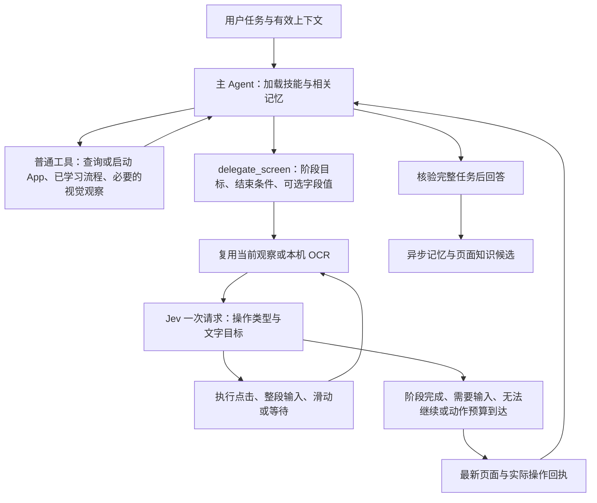

# Jev 协同执行

更新：2026-10-20。Jev 是正式执行模式中的页面操作选择器，与普通模式共用主 Agent、Skill、会话、长期记忆和学习队列。

## 责任与流程

主 Agent 始终掌握完整任务。它读取有效上下文、按需加载技能、选择 App、确定阶段目标和输入值，并根据真实页面与操作回执给出最终答案。Jev 只处理被委派的当前阶段，不能生成最终答复。

因此“打开微博，看第一条热搜”不会由 Jev 在首页选择结束后直接输出整页 OCR。Jev 的 `subgoal_done` 只交回首页证据；主 Agent 继续检查目标是否达成，决定下一阶段，最终回答有排名依据的内容。自动化回归覆盖这条调度路径；真实模型能否正确理解所有页面仍需真机验收。

| 部分 | 职责 |
| --- | --- |
| 主 Agent / Harness | 完整上下文、Skill 与记忆、阶段规划、准确输入文本、工具调度、最终答复 |
| Jev | 当前阶段内，从 OCR 文字区域和已声明操作中选择下一步 |
| 程序执行器 | 候选绑定、真实工具调用、读取新页面、保存回执、阶段交回、取消与预算 |
| iOS 适配 | 本机截图/OCR、设备连接、坐标转换、授权、输入和后台生命周期 |
| 异步学习 | 复用主 Agent 绑定账户，处理用户偏好与已过滤的页面骨架，候选审核后启用 |

## 委派契约与模型输入

主 Agent 通过原生 tool call 调用 `delegate_screen`，不需要额外输出路由 JSON。该工具一次单独调用，返回后才能继续其他工具，以免忽略阶段中实际发生的页面变化。

| 参数 | 含义 |
| --- | --- |
| `goal` | 当前局部目标，不是把整个用户任务原样交给 Jev |
| `completion` | 可以从页面观察到的阶段结束条件 |
| `input_text` | 可选，一个字段的完整输入值 |
| `input_purpose` | 与输入值同时提供，说明字段用途及适用页面 |

Jev 每次接收局部目标、完成条件、当前 OCR（帧 ID、尺寸、候选 ID、文字、置信度、边界框）、本阶段实际执行记录以及尚未消费的输入值。它不承担从整段用户话语中切割搜索词、联系人或正文的职责。

输入由主 Agent 结合会话决定，使用 `type_text` 一次填写完整文本。一个阶段最多消费一次该值；之后需要另一字段时返回 `need_input`。输入工具不自动清空或提交。程序不枚举所有子串、不猜测内容，也不把“继续”直接当作搜索词。

在同一个 TypeSafe 请求中提供两个独立 Choice：

- `operation`：点击、输入、需要输入、上/下滚动、等待、阶段完成、无法继续。
- `tap_target`：本帧各个 OCR 文字区域，仅当操作为点击时读取这个答案。未使用的目标答案不影响输入、等待或交回。

操作类型与大量具体按钮不再挤进同一个概率分布。OCR 超过单题 255 个候选时按组预选，再从各组结果中选择；不按 OCR 置信度丢弃目标。没有文字候选时仅发送操作题。

Jev 只接收文本，不启用图片接口。主 Agent 遇到纯图标、遮挡或缺少视觉状态时，可以显式调用现有 `screenshot` 工具，图片只发送给绑定的主模型；该模型须具备对应图片能力。OCR 足够时不额外询问模型“是否截图”。

## 交回与失败处理

每次阶段结果包含 `status`、`overall_success: false`、阶段目标、最新 `screen`、`actual_actions` 与 `input_consumed`。这个工具调用返回成功，只代表阶段回执完整，不代表用户任务成功。

| 状态 | 主 Agent 接下来做什么 |
| --- | --- |
| `subgoal_done` | 根据返回证据核验阶段；继续下一阶段或核验完整任务后回答 |
| `need_input` | 确定当前字段应填写的完整值，或向用户补充询问必要信息 |
| `blocked` | 检查实际回执；需要时读取图像、改用已有工具或重新规划 |
| `step_limit` | 当前阶段已执行 8 个动作，带最新观察交回主 Agent 决策 |

保留最高概率直接选择：没有最低概率、置信度分档、概率总和或候选全集一致的执行门槛。并列时优先用服务端选择，否则按本轮请求顺序；未知的最高项明确失败，不能偷偷改选次高项。

仍然保留执行契约：候选属于当前帧、坐标合法、目标画面有效、运行未取消且连接/授权正常。OCR 是文字区域，不是控件树，不能把任何文字都当按钮。

已明确“当前动作未发送”的画面纠错，会把此前已送达动作和新观察交回主 Agent。连接失败、输入送达未知和协议损坏仍沿原错误路径停止，不重放、不自动换模型。主 Agent 与 Jev 共用本轮模型预算和取消入口；预算耗尽不会伪装完成。

## 设置与解耦

1. 设置 → 供应商 → 添加 → **Jev 协同**。
2. 配置 TypeSafe 地址、API Key 和 Jev 模型。预置模型 ID 保持现有设置，可刷新供应商列表。
3. 显式选择“主 Agent 供应商”和“主 Agent 模型”。要求文本生成与工具调用；视觉操作还要求图片能力。
4. 在会话中选择该 Jev 供应商。入口目前接受文字任务；无专属 App Skill 仍能使用通用 iOS 工具。

已有主模型绑定与密钥引用继续使用，不自动替换账户。原自动生成的“Jev OCR（试验）”名称显示为“Jev 协同”；用户自定义供应商名称保留。

核心不依赖 SwiftUI/UIKit、语音或 VPN。`AgentSessionController` 只负责组合依赖；没有第二套独立 Jev 整轮任务引擎。后台执行与连接模块沿用现有实现。

## 代码与提示词

- [主 Agent 提示词](../ios-app/TapitoAgentKit/Sources/TapitoAgentSwiftAgentKit/WorkflowPrompts.swift)：`common`、`execution`、`jevDelegation`；修订号 `harness-2026-10-20.1`。明确完整任务核验、准确字段值和交回语义。
- [HarnessAgentEngine](../ios-app/TapitoAgentKit/Sources/TapitoAgentSwiftAgentKit/HarnessAgentEngine.swift)：唯一主循环，共享技能加载、模型预算、工具回执、取消和最终答案。
- [HarnessTools](../ios-app/TapitoAgentKit/Sources/TapitoAgentSwiftAgentKit/HarnessTools.swift)：`delegate_screen` 的原生工具 schema。
- [JevScreenExecutor](../ios-app/TapitoAgentKit/Sources/TapitoAgentCore/JevScreenExecutor.swift)：Jev 通用提示词、阶段执行、输入消费、OCR 分页和交回结果。
- [JevDecisionClient](../ios-app/TapitoAgentKit/Sources/TapitoAgentCore/JevDecisionClient.swift)：`/systemone` 多问题请求、按需解析答案、最高概率选择。
- [AgentSessionController](../ios-app/Tapito/Agent/AgentSessionController.swift)：供应商绑定、设备适配、长期记忆与异步学习装配。

提示词不写死 App 按钮和坐标；App 页面知识从相应 Skill 按需读取。Jev 的当前目标由主 Agent 动态生成。

诊断包括 `harness.model.*`、`jev.model.*`、`jev.operation`、`jev.target`、`jev.response`、`jev.handoff` 和 `harness.tool.*`。记录调用轮次、耗时、候选 ID、概率、阶段状态及动作数量，不记录输入正文或响应正文。会话执行记录沿用每步耗时展示。

## 设计依据

以下为 2026-10-19 调研记录，不代表本轮重新测速或验证供应商服务：

- [TypeSafe API](https://docs.typesafe.ai/api)、[Function calling](https://docs.typesafe.ai/cookbooks/function_calling)：原生 `state` + `questions`，Choice 将选择绑定到程序操作。
- [Confidence](https://docs.typesafe.ai/confidence)：分布置信度不等于点击或业务成功率。
- [Jev-Mobile](https://arxiv.org/html/2609.30186v1)：高层模型委派局部目标、Jev 进行局部动作选择。其 Android 控件树实验不能直接证明 iPhone 中文 OCR 的效果。

本次移除了旧独立循环的“Jev 结束即整轮结束”和直接输出整页 OCR；早期字符索引、prepare/fill 辅助模型路径也已被主 Agent 的阶段委派替代。

## 本轮验证

2026-10-20：

- 86 项 Agent 主机测试通过。覆盖首页提前 `subgoal_done` 后主 Agent 继续、Skill/记忆注入、多问题 HTTP、完整输入值只消费一次、纠错时保留已送达前缀、取消、共享预算、低置信度直选、分页与未知送达结果停止。
- 12 项 OCR 选择与画面稳定性测试通过。
- iPhoneOS `build-for-testing` 成功：App、扩展及测试目标编译通过。产物位于 `/tmp/tapito-jev-delegation-device/Build/Products/Debug-iphoneos/Tapito.app`，未签名、未安装。

测试使用脚本模型与本地 HTTP 响应，不调用真实供应商、不操作手机、不启动模拟器。回归通过证明调度与契约，不等于真实模型判断或真机任务成功率。

验证日志：`/tmp/tapito-jev-delegation-tests.log`、`/tmp/tapito-jev-delegation-ocr.log`、`/tmp/tapito-jev-delegation-iphoneos.log`。
