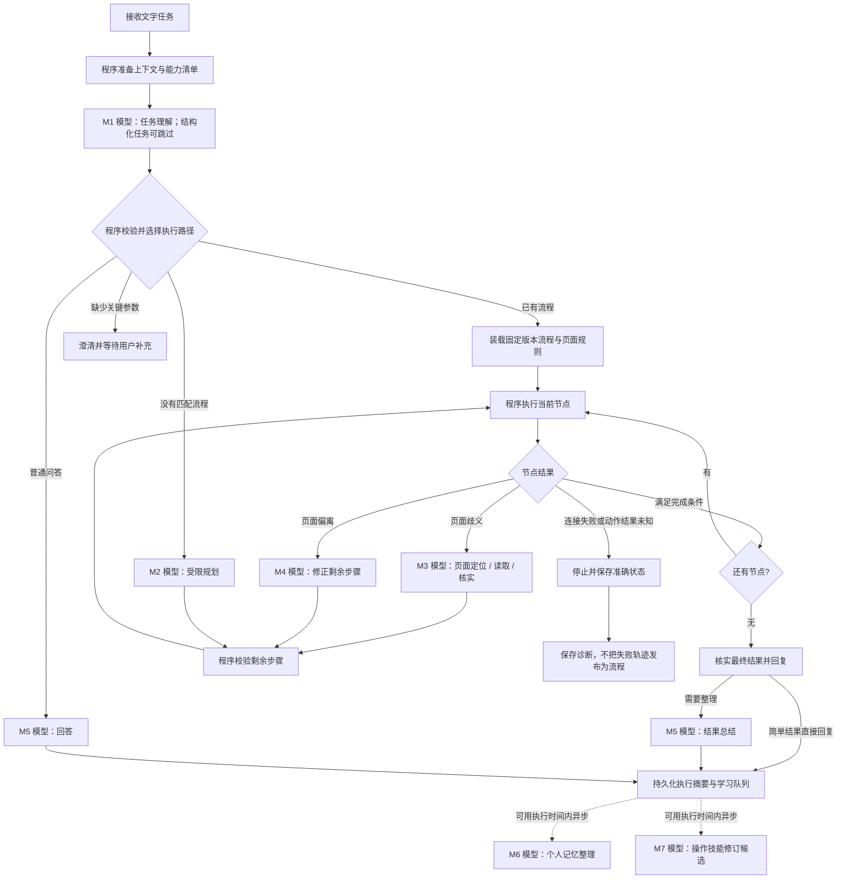

# Tapito 正式任务执行流程：程序编排与按需模型调用

> 2026-10-16 实现更新：正式 live 入口已接入程序工作流。当前可执行契约、实际提示词和验证边界以 [运行实现](Tapito-WORKFLOW-RUNTIME.md) 为准；下文的早期设计示例和分阶段记录保留作背景。

调研日期：2026-10-16。状态：设计建议，尚未实现；本次交付为设计文档与流程图，不修改运行代码、不安装、不执行手机任务。

配套：[模型节点 M1–M7、完整提示词与输入输出校验](Tapito-WORKFLOW-MODEL-PROMPTS.md) · [可视流程图](assets/tapito-workflow-model-nodes-v1.png)。模型是否调用由明确的流程条件决定，不是每个任务都执行所有模型节点。

## 结论

采用“程序管理流程状态，模型处理语义与未知情况”的执行方式。固定的是任务生命周期、常用操作步骤、分支条件、动作回执和结果校验；页面定位与动态内容读取按需使用本地特征、OCR 或视觉模型。

既不要求每个点击前后都调用模型，也不承诺所有任务都能变成永久不观察的坐标脚本。流程内必须允许模型节点；没有现成流程的新任务也必须有明确、有预算的探索路径。

下文的正式流程是针对 Tapito 的设计判断，不是某个外部项目已经证明的 iPhone 实现。

## 一、网上案例与可迁移部分

| 一手来源 | 已核实的机制 | 对 Tapito 的启发与适用边界 |
| --- | --- | --- |
| [Anthropic：Building effective agents](https://www.anthropic.com/engineering/building-effective-agents) | 区分程序预定义路径的 workflow 和模型动态决定路径的 agent；示例包括分类路由、模型节点和程序检查 | 常用任务采用可验证的流程；开放问题才增加动态决策。这是架构指导，不是 iPhone 性能基准 |
| [LangGraph：Workflows and agents](https://docs.langchain.com/oss/python/langgraph/workflows-agents) | 官方代码把模型调用定义为节点，以普通函数检查输出，通过条件边选择后续节点 | 模型是图中的一个节点；图可以既包含程序节点，也包含模型节点。借鉴机制，不把 Python 框架搬进 iOS |
| [Browserbase：Stagehand](https://www.browserbase.com/stagehand)、[项目源码及示例](https://github.com/browserbase/stagehand) | 确定性浏览器 API 与 act/observe/extract 模型能力可以混合；支持复用解析结果的缓存 | 已知导航由程序执行，变化部分才调用模型；缓存定位方法，不能照搬网页 DOM 定位或缓存实时业务结果。当前官网已介绍 v4；旧 v3 的 agent() 示例不视为当前统一接口 |
| [AppAgent 官方仓库](https://github.com/TencentQQGYLab/AppAgent)、[AppAgent v2 论文](https://arxiv.org/abs/2408.11824) | 探索/人工演示阶段积累控件操作知识，执行阶段使用已有知识；v2 描述知识检索与更新 | 将执行与学习分开，保存可复用页面知识。原仓库针对 Android，论文与演示不证明 Tapito 的 iPhone 权限、控制能力或免 OCR 效果 |

没有采用网页宣传的提速百分比作为 Tapito 的预期收益，也没有对这些项目运行独立性能测试。

## 二、ticket-agent 实际参考点

本次查看 `/Users/y175/code/OnlineTicketBookingSystem/ticket-ai/ticket-agent` 当前本地文件。该 checkout 的 HEAD 为 `caeda440f4`，但结论来自读取的工作区内容，不代表该提交或线上部署一定包含全部内容。

1. **意图识别后由程序派发目标。** `WorkflowIntentEngine` 根据解析出的目标类型进入 Knowledge、Dify Workflow 或 Graph 分支；不是让模型临时拼任意执行入口。见 [WorkflowIntentEngine.java](/Users/y175/code/OnlineTicketBookingSystem/ticket-ai/ticket-agent/src/main/java/com/ticket/agent/agent/intent/core/WorkflowIntentEngine.java:730)。Tapito 可对应为“会话回答 / 已知操作流程 / 未知任务探索”。
2. **Graph 管理节点和分支。** `GraphRuntimeCompiler` 将 `GraphPoint` 与边编译为 `StateGraph`，`GraphEdgeSpec` 支持直接边与条件边。见 [GraphRuntimeCompiler.java](/Users/y175/code/OnlineTicketBookingSystem/ticket-ai/ticket-agent/src/main/java/com/ticket/agent/agent/graph/runtime/GraphRuntimeCompiler.java:36)、[GraphEdgeSpec.java](/Users/y175/code/OnlineTicketBookingSystem/ticket-ai/ticket-agent/src/main/java/com/ticket/agent/agent/graph/runtime/GraphEdgeSpec.java:80)。这是 Tapito 执行主干最值得复用的设计。
3. **Harness 负责模型、工具和技能装配。** 当前代码使用 `HarnessAgent.builder()` 装配 model、toolkit、skillRepositories、memory middleware 与运行状态；POM 标明 AgentScope 2.0.2。见 [HarnessAgentService.java](/Users/y175/code/OnlineTicketBookingSystem/ticket-ai/ticket-agent/src/main/java/com/ticket/agent/agent/harness/HarnessAgentService.java:478)、[pom.xml](/Users/y175/code/OnlineTicketBookingSystem/ticket-ai/ticket-agent/pom.xml:20)。Harness 仍包含模型驱动的 ReAct 路径，不能把它本身当作减少逐步模型请求的方案；Graph 与 Harness 在该项目中也不是一个自动串联的执行器。
4. **语义判断与确定性检查分开。** 项目 Graph 文档要求模型输出有限的 JSON 动作，再用程序核对有效标识与条件。见 [graph-engine.md](/Users/y175/code/OnlineTicketBookingSystem/ticket-ai/ticket-agent/docs/graph-engine.md:198)。Tapito 应校验流程 ID、节点类型、参数、当前页面证据和动作范围，不执行模型任意产生的脚本。
5. **长期记忆维护脱离交互主链。** `HarnessMemoryService.collect` 持久化本轮来源；独立执行器领取队列，调用记忆模型整理，使用版本检查写入，并区分 DONE、NO_FACTS、FAILED 等状态。见 [HarnessMemoryService.java](/Users/y175/code/OnlineTicketBookingSystem/ticket-ai/ticket-agent/src/main/java/com/ticket/agent/service/memory/HarnessMemoryService.java:157)、[后台维护入口](/Users/y175/code/OnlineTicketBookingSystem/ticket-ai/ticket-agent/src/main/java/com/ticket/agent/service/memory/HarnessMemoryService.java:269)。Tapito 借鉴队列、来源与版本隔离，不照搬服务器定时常驻、Mongo、Redis。

## 三、正式执行主流程



### 1. 准备由程序完成

建立 runID、当前用户任务、供应商与能力快照，检索有限相关记忆，取得技能目录、已启用流程、设备状态与已安装 App 信息。App 清单缓存须带刷新与版本校验条件，不能把过期版本当现状。

这些准备动作无需让模型分别发起 load_skill、search_memory、list_apps、list_workflows。先提供精简目录；明确目标后由程序载入所需正文与流程，避免一次装入所有 App 文档。

普通问答不先建立屏幕控制会话；手机操作由宿主按需检查连接和执行资格。

### 2. 模型只解析需要语义理解的内容

自然语言入口通常调用一次模型，输出受约束的任务结构，例如：

```json
{
  "kind": "device_task",
  "app": "weibo",
  "operation": "read_hot_search",
  "arguments": {"count": 10}
}
```

这是字段示例，不是已实现 API。程序核对 app/operation 是否属于已注册能力，解析实际 bundle ID。含糊的目标或缺失参数走澄清节点，不能凭模型置信度猜测。已带准确参数的快捷指令可直接进入流程，省去语义解析。

### 3. 程序选择流程，模型不再逐项安排固定准备工具

匹配任务语义、参数、适用版本与已发布状态后，装载流程快照。本轮执行期间不因学习写入而改变版本。

常用流程包含前置条件、步骤、完成条件与已知分支。没有匹配流程时，明确进入受限探索路径；模型可以规划未知部分，但仍通过同一执行器、回执与取消机制。不能用名称相似的流程充当匹配。

### 4. 流程节点明确声明所需观察

建议第一版保留少量节点：启动 App、定位目标、执行动作、读取内容、模型处理、条件分支、结果校验。等待属于具有期限的页面就绪检查，避免固定长延时。

观察策略不等于“所有节点依次尝试坐标、OCR、视觉”：

| 节点需求 | 程序行为 |
| --- | --- |
| 启动已知 App、已确认焦点后整段输入 | 直接执行对应能力，保持前置条件与回执检查 |
| 已发布定位方法且页面/目标特征匹配 | 本机新截图校验后按有效坐标执行，不调用 OCR 或模型 |
| 已知页面中的明确文字目标 | 本地 OCR；结合页面身份、目标区域、唯一性和预期用途确定目标，满足规则后直接执行 |
| 纯图标、布局含糊、多候选、页面未知 | 将当前帧交给视觉模型做结构化定位；校验返回的帧、范围、目标与允许动作 |
| 读取热搜、消息、商品等动态内容 | 读取当次内容，不能返回以前缓存的结果；OCR 可满足时本地提取，复杂布局按需用模型 |

OCR 成功且无匹配目标可以进入显式视觉分支；OCR 引擎错误、截图失败、模型协议错误必须保留原错误，不能伪装成“没找到目标”。已知是图标的节点可以直接调用视觉，避免为此先做一轮无用 OCR。

同一帧可以复用其 OCR 与图片；动作改变页面后，不能拿旧帧证明新页面。OCR 文字置信度不等于控件可点击或业务动作正确。

### 5. 执行与验证由程序推进

动作统一经过现有设备适配、任务授权、代际与取消栅栏。区分准备、已发送、已收到回执、效果已验证、结果未知；送达不能直接变成业务成功。

对“聚焦后立即输入”等稳定片段，可作为有明确前置/后置条件的连续动作段，在输入后核验，避免为每次微动作额外引入模型轮次。学习记录也必须理解这类动作段，解决当前聚焦后直接输入却因缺中间截图被拒绝的问题；不能复制旧截图伪装新证据。

页面偏离时，携带当前节点、已执行动作、最新观察与允许的剩余目标进入模型修正。模型返回局部定位或剩余步骤，程序验证后继续。限定修正次数与耗时；越界、缺依据或耗尽预算时明确停止。

动作已经发送但结果未知时，先只读核查；无法确认就停止。不能因为重规划、恢复运行或模型报错而从头重发消息、重复创建备忘录。

### 6. 完成回复不必每次再调用模型

简单任务有明确结构化结果时，直接生成完成说明；要求总结、比较、推荐时才调用模型整理结果。真实榜单、联系人、发送状态必须来自当次观察，不能仅凭流程末页相似或模型的“完成”判断。

## 四、以微博热搜为例

自然语言理解 → 程序选中 `weibo.read_hot_search` → 启动微博 → 识别当前页面 → 按流程进入热搜榜 → 核对榜单标题 → 读取当次前 N 条 → 输出原列表或按要求总结。

在页面规则全部匹配、OCR 能提取榜单的情况下，导航无需模型逐步参与。自然语言解析一次，需要总结时再一次；这是该条件下的调用预算目标，不是所有任务的次数上限或已测性能。遇到图标、弹窗、歧义、复杂语义时，额外调用必须有明确节点与原因。

“进入微博 → 打开热搜榜”可以复用；热搜内容不能复用。微信的“打开搜索 → 输入联系人 → 核实目标 → 进入会话 → 输入文本”可以沉淀分段流程，但“点击列表第一行”不能变成跨任务固定收件人坐标。

## 五、技能、记忆与自更新

技能包由现有说明文档扩展为：适用 App/版本、操作与参数、流程定义、页面规则、目标定位规则、完成条件、修订证据。说明文档服务于未知场景和纠错，常用流程通过程序执行。

分别保存三类信息：

- 个人记忆：用户明确表达且有长期价值的偏好或事实，带用户原话来源、修订和删除隔离。
- 任务记录：已尝试什么、观察到什么、哪里失败、哪些动作结果未知；失败也应有诊断，不自动变成成功技能。
- 操作知识：稳定页面锚点、适用条件、有效定位、连续动作段和校验方式，不保存消息正文或把动态目标固化成旧坐标。

前台主链只持久化待处理记录；异步任务分析、去重、参数化并生成候选。可按需调用独立模型整理，但不占用当前任务的每一步模型往返。候选通过证据校验和已有审核机制后发布为新版本；保留失败原因与回退能力。成功次数多不自动证明对其他联系人、设备或页面也正确。

iOS 只在有运行资格时处理队列，未完成记录下次继续。异步不表示无限后台常驻，也不应重新占用执行阶段已释放的麦克风或音频。

## 六、代码解耦与实施顺序

继续以 `TapitoAgentKit` 为核心，扩展现有 `WorkflowExecutor` 与流程模型，避免另建一套互不相通的运行系统：

- 核心包管理任务结构、流程状态、节点结果、分支、预算、回执、修订和学习队列。
- 模型端口负责结构化语义解析、视觉定位、局部修正、结果整理；复用现有 ProviderKit/供应商配置。
- 设备端口通过 ActionCoordinator 复用连接、截图、OCR、触控与整段输入；UIKit/Vision 等细节留在 iOS 适配层。
- UI、语音与灵动岛订阅中立事件；后台资格继续由宿主管理，不进入流程定义。

建议按以下顺序交付，避免一次重写所有 App 操作：

1. 补齐节点计时、模型分阶段错误与运行关联号；修复“聚焦+输入”学习证据冲突。
2. 将准备、解析、流程选择从模型工具循环中抽出；实现最小节点与条件分支。
3. 先打通只读的微博热搜流程，再验证备忘录创建与时钟操作；微信/QQ 涉及动态对象识别，按实际证据逐项接入。
4. 将异常探索限制在当前未完成步骤；随后接入异步的节点/片段知识沉淀。

## 七、验收与排错

本次已取到的昨晚微信样本：26 次工具调用、24 个模型轮次记录；6 次 OCR 后均请求上传同一帧图片；OCR 识别耗时合计约 1.18 秒；从用户消息到学习入队约 251 秒。单个样本不能代替 P50/P95，也不能把未细分的耗时全部归到模型。

每个节点至少记录 runID、nodeID、flowRevision、开始/结束时间、观察帧 ID、执行路径（本地定位/OCR/视觉）、模型请求关联号与错误类别。模型日志保留 HTTP 状态或协议阶段、耗时和脱敏原因，不写密钥或完整私人屏幕内容。

对相同任务与相同起始页面比较：业务成功率、误点/重复输入、模型调用数、视觉上传数与字节、截图/识别/模型/输入/页面等待各段耗时、流程命中率与纠错次数。熟悉流程的目标是模型不参与每个导航步骤，而不是强行省略必要观察。

验证覆盖：原页面、不同起始页、已知弹窗、同名目标、主题/版本变化、用户停止、截图失败、模型格式错误、动作送达后断连、学习队列拒绝与恢复。重构只有在这些路径通过后才替代现有主执行路径。
