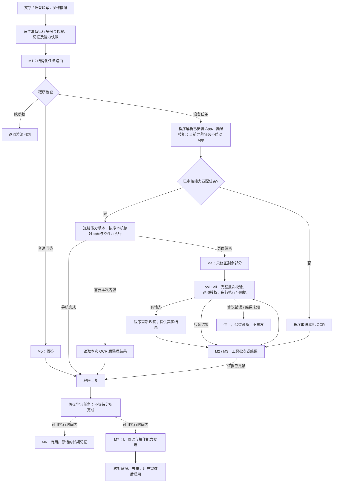

# Tapito 程序工作流：实现与验收

日期：2026-10-16。本文描述已接入正式 live 入口的代码。早期设计稿中的示例 JSON 不等于当前调用接口。原始架构目标见 [总体设计](Tapito-WORKFLOW-EXECUTION-DESIGN.md)。

## 实际运行路径

自然语言入口固定先做一次 M1；当前未新增可以跳过 M1 的结构化快捷指令接口。M1、M2/M3、M4、M5 使用本轮已选供应商；M6/M7 使用独立客户端和上下文，但仍固定原供应商/模型，绝不静默切换。

普通探索中的 M3 可以根据已观察结果直接回复，不再额外调用一轮 M5。没有单独的“问模型要不要 OCR”步骤。程序在探索开始、改变页面的工具批次结束后观察；纯图标、歧义及复杂内容仍允许模型明确请求同帧截图。

## 模型与工具契约

实际提示词唯一来源是 [WorkflowPrompts.swift](../ios-app/TapitoAgentKit/Sources/TapitoAgentSwiftAgentKit/WorkflowPrompts.swift)，修订 `workflow-2026-10-16.1`。程序接口在 [WorkflowAgentEngine.swift](../ios-app/TapitoAgentKit/Sources/TapitoAgentSwiftAgentKit/WorkflowAgentEngine.swift)。

| 节点 | 实际输出 / 程序约束 |
| --- | --- |
| M1 | 一个 `route_task` 调用：`kind`、`target_mode`、`app_bundle_id`、`app_name`、`skill_ids`、`flow_id/revision`、`texts`、`page_calls`、`requires_summary`、`completion_kind`、`question`。类型、能力 ID、版本、参数由程序校验 |
| M2/M3 | 只调用已注册执行工具；完整批次预检后串行执行。工具回执与调用 ID 一一对应 |
| M4 | 仅页面偏离或明确“输入未发送、需要观察”的错误可进入；携带已完成能力列表和当前段送达状态；禁止重放已执行部分 |
| M5 | 回答或整理本轮真实结果；导航匹配、命令送达与业务成功明确区分 |
| M6 | `store_memory_proposals`；来源须匹配用户原话，更新须带原修订，清理/关闭自动记忆使旧输出失效 |
| M7 | `store_page_candidates`；只能标注真实 evidenceID 的页面名、功能和观察结果，不能自行生成坐标；看不到 M6 私人输入或页面图像样本 |

主链总预算 32 次模型请求；每批最多 16 个工具、每个页面能力序列最多 16 段；最多 2 次观察纠错。模型流必须完整结束，截断或协议失败不执行部分调用。普通会话不调用设备工具；App 切换仅使用本轮查询得到的标识。

程序准备阶段不让模型分别调用 load_skill / search_memory / list_apps / list_workflows。基础技能及备忘录、时钟、微信、微博、QQ 的匹配技能由宿主装配；模型仍可选择其他已启用的相关技能。跨 App 任务可以在探索分支切换已验证 App；一段已发布能力序列只针对一个 App。

## 页面知识保存什么

- App 与系统版本、截图像素宽高、实际执行帧 ID、运行来源。
- 固定 UI 标签及边界框。标签来自保守 UI 词表，至少两个锚点；这是 OCR 骨架，不是系统可访问性控件树。
- 控件的实际点击位置、功能、操作类型、操作前后页面元素与观察结果。
- 文字控件只保存文字框内部的低分辨率样本。视觉控件仅在顶部/底部工具区采集，保存局部图像 SHA-256 摘要和实际坐标，不保存原图，也不把动态列表行、联系人头像或商品内容作为通用位置流程。
- 整段输入是当前参数；`tap → type_text` 连续批次可记录为“聚焦并输入”动作段，不要求虚构中间截图。

新采集的页面知识不存储消息、联系人名称、热搜正文、输入值或完整截图。历史对话与个人记忆是单独的已有存储；持久学习队列保留本轮用户来源供 M6 核对，可在管理界面清理。

已审核能力优先使用当前截图的 UI 样本与控件摘要进行本机核对，不做 OCR、不向模型上传图片。没有样本的明确能力采用本机 OCR 校验。页面变化、分辨率/版本不符会停止该序列并隔离旧版本，绝不无条件沿用坐标。只读页面就绪最多观察 4 次、间隔 250 ms；截图/协议异常不重试。

发送、删除、确认等业务控件和非搜索字段的输入，不能仅凭旧页面骨架直接进入坐标快速路径，仍需当次任务上下文核实。动态收件人、消息与榜单内容必须重新读取。局部图像匹配不等于所有 UI 状态都可被识别；无法确定的步骤继续走有预算的模型观察。

## 学习、修订与管理

入口：设置 → 记忆与学习 → **页面功能、控件与学习记录**。可以查看位置、页面功能、前后基础 OCR 元素，审核启用、停用或删除；失效版本不能直接重新启用。

队列落盘、串行领取；M6/M7 不阻塞当前任务返回，也没有设备操作端口。相同证据去重；新候选不覆盖正在运行的快照。发布前保留审核，页面偏离后的纠错证据可以形成新候选。清理或用户修改知识库时，已发出的旧分析结果被拒绝，不会再次循环生成被删除内容。

供应商端点、账户、协议身份在入队时固定；配置改变或原供应商删除，任务明确失败，不把历史输入发送给新的服务。失败原因、节点、耗时与队列状态可诊断。学习不是无限后台常驻；系统暂停后保留 pending，下次应用获得执行时间再处理。不会重新获取麦克风或启动音频。

容量为 100 个队列记录、300 个页面能力、8 MiB 存档；超限明确提示清理，不静默丢弃已有知识。任务来源、候选、个人记忆分别校验；不同存档之间没有跨文件数据库事务，I/O 失败会显示错误，个人记忆按来源运行保持幂等。

## 解耦边界

| 位置 | 责任 |
| --- | --- |
| `TapitoAgentCore` | 中立事件、会话状态、页面知识、执行器、记忆与持久学习队列；不引用 SwiftUI、UIKit、语音、VPN |
| `TapitoAgentSwiftAgentKit` | M1–M7 提示词、结构校验、模型流、程序分支、工具调度；复用 ProviderKit |
| iOS `ActionCoordinator` | 现有权限、连接、截图、Vision OCR、像素采样、触控和整段输入；所有动作仍有回执和停止栅栏 |
| `AgentSessionController` | 组合依赖，桥接宿主生命周期、存储和事件；正式 live 入口选择新程序运行时 |
| UI / 语音 / 灵动岛 | 订阅中立事件和调用现有入口；后续 UI 重构无需修改流程引擎或页面库 |

离线演示与已有 SDK/展示测试显式使用 `reactFixture`；它不是正式执行失败后的兼容降级。新增程序运行时测试独立覆盖新入口。

## 本轮验证

- macOS Swift Package 核心测试：54 项、10 个测试套件全部通过，见 `.build/agent-workflow-v3-tests.log`；包括程序路由、实际 Tool Call、整批预检、无逐步模型调用、消息关联、未知结果停止、取消、旧帧拒绝、清理隔离、队列恢复、来源校验、M6/M7 上下文隔离。
- iPhoneOS `build-for-testing` 无签名构建通过：见 `.build/agent-workflow-v3-build.log`。App、扩展和 XCTest 目标完成编译；未运行模拟器或真机 XCTest。
- iOS 适配测试覆盖局部图像采样、无 OCR 回放仍经过授权/回执，以及正式程序运行时的会话入口；本轮仅编译，未执行。
- 本轮没有安装、真实模型调用、手机点击、业务发送或耗时基准。未宣称真机 P50/P95 提速，也不宣称五个 App 的全部页面流程已经沉淀。
- 辅助 `check_source.py` 因本机缺少 `tree_sitter` 未运行；Swift/Xcode 编译结果独立记录，不把源文本断言当成运行验证。
