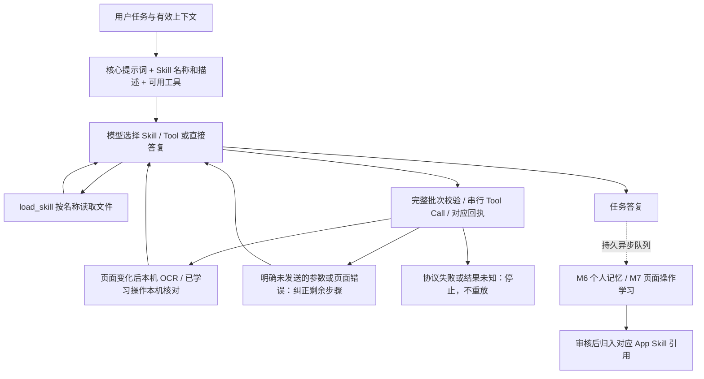

# Tapito 程序工作流：实现与验收

日期：2026-10-19。本文描述已接入正式 live 入口的代码。早期设计稿中的示例 JSON 不等于当前调用接口。原始架构目标见 [总体设计](Tapito-WORKFLOW-EXECUTION-DESIGN.md)。

## 实际运行路径

正式入口为 `HarnessAgentEngine`，使用同一个 ReAct 工具循环，不再使用 M1–M5 固定分支或 `route_task`。

App 任务由模型实际调用 `list_apps`，随后用返回的 Bundle ID 调用 `launch_app`。中文微信与系统英文 WeChat 不做字符串相等判断。普通聊天可直接回答；当前屏幕任务不要求查询或启动 App。

App 专属知识按 App 独立成 Skill，通用 `ios-operation` 适用于有或没有专属技能的 App。`available_skills` 是操作知识目录，不是 App 白名单；没有匹配项时只加载通用技能，查询真实安装目录、启动应用、根据当前 OCR／必要时截图调用工具，不要求先学习或创建专属 Skill。起始只提供名称、描述和 `load_skill` / `list_apps`；加载基础操作技能后，下一次模型决策使用已启用的设备工具定义。模型不填写技能 UUID/修订，宿主按名称绑定本轮不可变快照。

已审核页面及流程在运行时生成对应 App Skill 的 `references/learned-operations.md`：页面功能、固定控件位置、版本、前后页面元素、预期结果，以及 `run_page` / `run_workflow` 所需引用。未审核候选不进入可执行目录。结构化存档是唯一执行来源，Markdown 是按需读取的模型视图；不是两份独立维护的数据。

## 模型与工具契约

实际提示词见 [WorkflowPrompts.swift](../ios-app/TapitoAgentKit/Sources/TapitoAgentSwiftAgentKit/WorkflowPrompts.swift)，修订 `harness-2026-10-19.1`。引擎见 [HarnessAgentEngine.swift](../ios-app/TapitoAgentKit/Sources/TapitoAgentSwiftAgentKit/HarnessAgentEngine.swift)。

- 每轮声明当前可用工具，完整模型终态后才允许执行；截断、重复调用 ID、损坏协议明确失败。
- 整批参数预检通过后串行执行，调用 ID 与回执一一对应。预检失败时本批均未执行，模型最多连续纠正两次。
- 已明确未发送的操作或页面偏离可观察后纠正；已执行部分不重放，未知结果直接停止。
- 输入后的观察由程序负责，无需模型另问“是否 OCR”。已有 OCR 充分时直接决策；需要图标或视觉状态才请求同帧截图。
- 已审核 `run_page` / `run_workflow` 仍由独立本机执行器核对当前画面与版本；不能用历史位置证明动态收件人或业务成功。
- 主链最多 32 次模型请求、每批 16 个工具。M6/M7 继续独立异步运行，不操作设备、不阻塞本轮答复，不静默更换供应商。

## OCR 与应用选择的本次调整

- App 身份只校验模型选择的 Bundle ID 是否属于本轮真实目录，不比较用户中文名与系统英文显示名。目录缺损/连接失败明确报错；只在确实未安装或真实歧义时澄清。任务记录持久化目录条数和选中标识，不保存模型原始响应或联系人内容。
- OCR 候选增加 `positions`，表示该文字相对所有同名候选的位置（包含分页外候选）。上下文明确时可用 `tap_text(position: topmost/bottommost/leftmost/rightmost)`，不额外上传图片。
- 相对位置必须与候选的非重叠边界一致；同坐标、重叠或错误方向不能通过。低置信度、过期帧、未知候选及实际未消除的歧义仍需纠正。控件位置不能用来推断同名联系人身份。
- 保留图标、图片及视觉状态所需的同帧截图。已取得有效 OCR 时直接决策下一步，不重复 OCR 或单独询问是否截图。

## 页面知识保存什么

- App 与系统版本、截图像素宽高、实际执行帧 ID、运行来源。
- 固定 UI 标签及边界框。标签来自保守 UI 词表，至少两个锚点；这是 OCR 骨架，不是系统可访问性控件树。
- 控件的实际点击位置、功能、操作类型、操作前后页面元素与观察结果。
- 文字控件只保存文字框内部的低分辨率样本。视觉控件仅在顶部/底部工具区采集，保存局部图像 SHA-256 摘要和实际坐标，不保存原图，也不把动态列表行、联系人头像或商品内容作为通用位置流程。
- 整段输入是当前参数；`tap → type_text` 连续批次可记录为“聚焦并输入”动作段，不要求虚构中间截图。

新采集的页面知识不存储消息、联系人名称、热搜正文、输入值或完整截图。历史对话与个人记忆是单独的已有存储；持久学习队列保留本轮用户来源供 M6 核对，可在管理界面清理。

已审核能力优先使用当前截图的 UI 样本与控件摘要进行本机核对，不做 OCR、不向模型上传图片。没有样本的明确能力采用本机 OCR 校验。页面变化、分辨率/版本不符会停止该序列并隔离旧版本，绝不无条件沿用坐标。只读页面就绪最多观察 4 次、间隔 250 ms；截图/协议异常不重试。

发送、删除、确认等业务控件和非搜索字段的输入，不能仅凭旧页面骨架直接进入坐标快速路径，仍需当次任务上下文核实。动态收件人、消息与榜单内容必须重新读取。局部图像匹配不等于所有 UI 状态都可被识别；无法确定的步骤继续走有预算的模型观察。

## 学习、修订与管理

入口：设置 → 记忆与学习 → **页面功能、控件与学习记录**。可以查看位置、页面功能、前后基础 OCR 元素，审核启用、停用或删除；失效版本不能直接重新启用。

队列落盘、串行领取；M6/M7 不阻塞当前任务返回，也没有设备操作端口。相同证据去重；新候选不覆盖正在运行的快照。发布前保留审核，页面偏离后的纠错证据可以形成新候选。清理或用户修改知识库时，已发出的旧分析结果被拒绝，不会再次循环生成被删除内容。

供应商端点、账户、协议身份在入队时固定；配置改变或原供应商删除，任务明确失败，不把历史输入发送给新的服务。失败原因、节点、耗时与队列状态可诊断。学习不是无限后台常驻；系统暂停后保留 pending，下次应用获得执行时间再处理。不会重新获取麦克风或启动音频。

容量为 100 个队列记录、300 个页面能力、8 MiB 存档；超限明确提示清理，不静默丢弃已有知识。任务来源、候选、个人记忆分别校验；不同存档之间没有跨文件数据库事务，I/O 失败会显示错误，个人记忆按来源运行保持幂等。

## 解耦边界

Jev 协同也使用下述 Harness。主 Agent 通过 `delegate_screen` 委派当前阶段；Jev 根据 OCR 选择局部操作，返回页面和回执，由主 Agent 继续决策及最终回答。配置、提示词与最新验证见 [Jev 协同执行](Tapito-JEV-OCR.md)。

| 位置 | 责任 |
| --- | --- |
| `TapitoAgentCore` | 中立事件、会话状态、页面知识、执行器、记忆与持久学习队列；不引用 SwiftUI、UIKit、语音、VPN |
| `TapitoAgentSwiftAgentKit` | Harness 与 M6/M7 提示词、参数校验、模型流、工具调度；复用 ProviderKit |
| iOS `ActionCoordinator` | 现有权限、连接、截图、Vision OCR、像素采样、触控和整段输入；所有动作仍有回执和停止栅栏 |
| `AgentSessionController` | 组合依赖，桥接宿主生命周期、存储和事件；正式 live 入口选择 Harness 运行时 |
| UI / 语音 / 灵动岛 | 订阅中立事件和调用现有入口；后续 UI 重构无需修改流程引擎或页面库 |

离线演示与已有 SDK/展示测试显式使用 `reactFixture`；它不是正式执行失败后的兼容降级。新增程序运行时测试独立覆盖新入口。

## 本轮验证

- 59 项 Agent 主机测试、10 个套件通过：`.build/harness-agent-tests.log`。覆盖中文 App 选择、名称加载技能、普通聊天、当前屏幕、整批参数预检、参数纠正、已执行部分不重放、重复 ID、截断模型、未知结果停止、取消、已学习页面调用及生成 Skill 引用。
- iPhoneOS 签名构建通过：`.build/harness-signed-build.log`。无签名首次构建遇到 Xcode 本地包源文件图未刷新；更新包清单并重新解析后签名构建通过。
- 独立运行诊断位于 Application Support/Tapito/AgentDiagnostics/<runID>.log，保留最近 30 轮；记录模型阶段、工具名称、参数错误字段和执行状态，不保存输入正文。
- 未启动模拟器、未自动执行真实 App 任务或播报语音。主机测试不代替真机端到端业务验证。

- 补充验证：`check_source.py` 通过（106 个 Swift 文件）；iPhoneOS `build-for-testing` 成功，仅编译未运行测试。
- 已安装至 175phone（com.y175.tapito），安装回执 `.build/harness-install.json` outcome=success，随后设备应用列表确认存在。安装未启动语音或真实任务。
